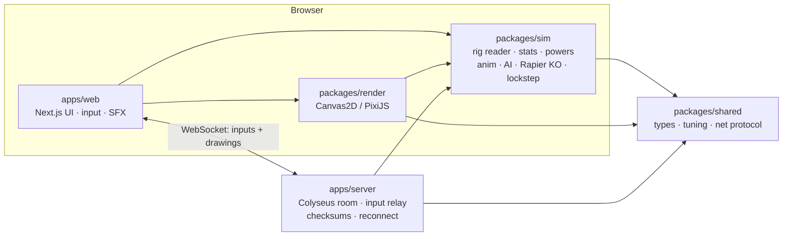

<div align="center">

# ✏️ Notebook Fighters

### Draw it. Scrub it darker. Make it fight.

Doodle a fighter in a notebook — a stick man, a dog, a car, a blob, anything — and it steps off the page and fights.<br>
The ink you draw *is* the body that moves: every stroke is rigged, skinned and animated, and the darker you scrub a part, the harder it hits.

[](https://nextjs.org)
[](https://www.typescriptlang.org)
[](https://colyseus.io)
[](https://rapier.rs)
[](LICENSE)


<!--
  The thumbnail below links to the MP4 in this repo (GitHub opens it in its file viewer).
  To get an inline video player in this README instead: edit README.md in the GitHub web editor,
  drag docs/media/notebook-fighters-demo.mp4 into the editor (≤ 100 MB for paid plans, ≤ 10 MB on free
  accounts — re-encode smaller if needed), and GitHub replaces it with a user-attachments URL that renders as a player.
-->
<a href="docs/media/notebook-fighters-demo.mp4"></a>

**[▶ Watch the demo](docs/media/notebook-fighters-demo.mp4)** · 66 s · 1080p60 · real gameplay

</div>

---

## Contents

[Features](#features) · [Screenshots](#screenshots) · [Controls](#controls) · [Getting started](#getting-started) · [Architecture](#architecture) · [Testing](#testing) · [Roadmap](#roadmap--known-gaps) · [Credits](#credits) · [License](#license)

## Features

### 🖍️ Draw anything — the recognizer reads it


A fully offline reader finds the **head, torso, arms and legs** in your strokes, builds a 15-joint rig and skins *your own ink* to the bones. It also understands **body plans**: biped, four-legged beast (trots in diagonal pairs), blob, snake, car (rolls and pops wheelies), tree, four-armed, even a lone circle. Extras become **tails, capes, hats and weapons**; a sword in the hand gives reach.

<br clear="right">

### 🌑 Scrubbing = strength, neatness = a bonus


Go over an arm four times and it punches **≈45 % harder**; a dark head or body means more HP — within a scribble budget, so nothing is best at everything. A **drawing-quality score** (detail, closed head, symmetry, dark parts, add-ons) gives a careful drawing up to **+10 % HP / +6 % damage**. The **Fighter Card** explains every number.

<br clear="right">

### ⚡ Draw a power, get a special
Doodle next to your fighter (shape **and** pencil colour count) and press **E / ★**:

| Doodle | Power | Effect | Counters |
|---|---|---|---|
| 🔥 zigzag / flame (red-orange) | **Fireball** | projectile, burns on hit | melts ice ×1.5 |
| 💧 wavy line / droplets (blue) | **Water wave** | wide wave | douses fire ×1.5 |
| ⚡ bolt "Z" (gold) | **Lightning dash** | dash through, stuns | shocks water ×1.5 |
| ❄️ asterisk / snowflake | **Ice shard** | shot that freezes / slows | freezes water ×1.5 |
| 🪽 loops on the back | **Wings** | double jump + dive | — |
| 🛡️ loop held at a hand | **Shield bash** | stops shots cold | — |
| 🦔 spikes along the body | **Spike burst** | hitting you hurts the attacker | — |


### 💪 Pre-drawn rivals — including a pencil Hulk
Eight hand-drawn computer opponents at real fighter height: **skinny kid, dog, boxer, karate guy, ninja, swordsman, pehelwan and the bodybuilder** — a green, cross-hatched pencil Hulk ≈20 % taller than you, whose heavily-drawn chest and arms really do hit harder. Easy / Normal / Hard pick the tier, and the CPU is balanced with a scripted "casual human" bot (every test drawing wins **41–63 %** on Normal).

 

### 👥 Local 2-player
Two kids, one keyboard: P1 on WASD, P2 on the arrows — each with their own drawing. On a touch screen each player gets their own pads. Best-of-3 with instant rematches.

### 🌐 Online rooms with deterministic lockstep
**Create room → share the 6-letter code or `/r/CODE` link.** A [Colyseus](https://colyseus.io) room relays inputs only; both browsers run the same deterministic sim (seeded CPU dice, deterministic Rapier build) with a small input delay, a checksum every second, and seat-holding reconnects (60 s) that rebuild from the input log. Tested at 100 ± 30 ms of lag: **0 desyncs**.

### 💥 Rapier ragdoll KOs + slow-mo replay
Knockouts hand the rig to a **Rapier2D (deterministic)** ragdoll — the dog folds with legs splayed, the car rolls onto its roof. Hits **freeze** for a few frames by weight, the victim squashes, the camera punches in, the KO **auto-replays in slow motion**, and **Save clip** exports the last 5 s as WebM.

### 🔊 Real, layered sound effects
52 **Kenney CC0** sounds, layered per hit: a swish on the swing-start frame, one of 5 punch/kick impacts on the exact contact frame (no repeats, ±4 % pitch), deeper thumps for the Hulk, block clacks, a KO stack (hit + boom + bell + body thud), and a sound for every power, the countdown and the FIGHT! bell. Falls back to synthesized audio if a file fails.

### 📱 Phone, tablet, gamepad — controls per device
Laptops show **only the keyboard legend**; phones and tablets show **only the touch pads** (thumb joystick + compact buttons, multi-touch, no scroll/zoom); a touchscreen laptop switches to whatever you actually use. Standard **gamepads** work everywhere. Rendered at full device-pixel resolution, so lines stay crisp.

## Screenshots

| | | |
|:---:|:---:|:---:|
| <br>**Draw & scrub** | <br>**Fighter Card** | <br>**The Hulk hits back** |
| <br>**Powers & counters** | <br>**Car, dog, snake, blob** | <br>**2 players · 1 keyboard** |
| <br>**Online, side by side** | <br>**Phone touch controls** | <br>**Slow-mo KO replay** |

## Controls

**Keyboard — 1 player** (either hand works)

| Move | Keys |
|---|---|
| Walk | `A` `D` / `←` `→` |
| Jump | `W` / `Space` / `↑` |
| Crouch | `S` / `↓` |
| Punch · Kick | `F` · `G` (or `J` · `K`) |
| Block | `H` / `Shift` |
| Special ★ | `E` (or `L`) |
| Next round / rematch | `R` |

**Keyboard — 2 players**

| | Player 1 | Player 2 |
|---|---|---|
| Walk | `A` `D` | `←` `→` |
| Jump · Crouch | `W` · `S` | `↑` · `↓` |
| Punch · Kick · Block | `F` · `G` · `H` | `J` · `K` · `L` |
| Special ★ | `E` | `;` |

**Touch** (phones & tablets)

| Control | Action |
|---|---|
| Left-thumb joystick | walk · push up to jump · down to crouch |
| **Punch · Kick · Jump · Block · Crouch · ★** | right-thumb buttons (multi-touch) |
| ☰ | menu: sound, engine, Save clip, tuners, back to notebook |
| Tap the banner | next round / rematch |

**Gamepad** (standard mapping — pad 1 → P1, pad 2 → P2)

| Control | Action |
|---|---|
| Left stick / D-pad | walk · up = jump · down = crouch |
| A | jump |
| X · Y | punch · kick |
| B / LB / LT | block |
| RB / RT | special ★ |

## Getting started

Requires **Node 20+** and **pnpm 10** (`corepack enable`).

```bash
pnpm i            # install the workspace
pnpm dev          # web app      → http://localhost:3100
pnpm server       # game server  → ws://localhost:2567  (only needed for online rooms)
```

| URL | What |
|---|---|
| `http://localhost:3100/` | the notebook: draw your fighter (and optional P2), pick a rival |
| `/play` | fight the computer · `?level=easy\|normal\|hard` · `?rival=bodybuilder` |
| `/play?mode=2p` | two players, one keyboard |
| `/online` · `/r/CODE` | create / join an online room |
| `?renderer=pixi` · `?physics=classic` | opt into the PixiJS renderer · use the classic verlet KO |

The online page connects to `ws(s)://<this host>:2567` by default; override with `?server=wss://host` or `NEXT_PUBLIC_NF_SERVER`. Production build: `pnpm build && pnpm start`.

## Architecture

```
notebook-fighters/
├── apps/
│   ├── web/             Next.js app: notebook (/), duel (/play), online (/online, /r/[code])
│   │   ├── app/play/      fight page, touch pads, gamepad, input-mode, layered SFX
│   │   └── public/sfx/    52 Kenney CC0 sounds (.ogg + .m4a) + CREDITS.md
│   └── server/          Colyseus room server (:2567) + headless lockstep test
├── packages/
│   ├── shared/          types, tuning constants, net protocol
│   ├── sim/             the game: rig reader, skinning, stats, powers, anim, AI, Rapier KO, lockstep
│   │   └── test/          headless tests + balance bot
│   └── render/          Canvas2D renderer (default) + PixiJS backend
├── e2e/                 Playwright browser checks (desktop, phones, tablets, online)
└── docs/                design plan, iteration log, media
```



The sim is pure TypeScript and fully deterministic (fixed step, seeded randomness, deterministic Rapier), so the same inputs replay the same fight — which is what makes lockstep online, KO replays and headless balance testing possible. The packages are consumed as TS source via `transpilePackages`.

## Testing

```bash
pnpm typecheck      # tsc --noEmit in every workspace package
pnpm test           # 15 headless sim suites: rig, shapes, recognize, duel, ko, powers, specials,
                    #   stats, edge, reach, versus, scribble, rivalcheck, rapier, roster
pnpm --filter @nf/sim test:duel     # …or any one suite
pnpm --filter @nf/sim balance       # casual-human bot vs the CPU on every level (win-rate table)
pnpm test:online    # headless 2-client lockstep: lag, drop + reconnect, page reload (needs pnpm server)
```

Browser checks (Playwright, against a running `pnpm dev`) live in [`e2e/`](e2e/README.md): per-device controls, phone/tablet layouts, Fighter Card, powers, 2P, game feel, SFX timing and a two-browser online match.

✅ **Latest full regression: all green** — `tsc` ×5 packages, 15 sim suites, `next build`, and e2e controls, sfx, mobile ×6 devices, card, powers, twop, human, feel and online (log in [`docs/ITERATIONS.md`](docs/ITERATIONS.md)).

## Roadmap & known gaps

- **Deploy** the web app (e.g. Vercel) and the Colyseus server on a public host so online rooms work across the internet — today the server must be reachable on port 2567.
- **Balance outliers:** on Easy the car and snake win ≈99 %; on Hard lightning (≈40 %) and four-armed (≈37 %) are a bit strong, shield and spikes sit near the 15 % floor. The Hulk is the toughest rival (≈19 % bot wins on Normal).
- **Reader edge cases:** a car drawn with its cabin dead-centre keeps its drawn direction; a tree fights as a big-headed figure; no sword parry yet.
- **PixiJS renderer** is opt-in (`?renderer=pixi`) — on a GPU-less box it ran 36–52 fps vs a steady 60 for Canvas2D; needs measuring on real GPUs.
- Online play adds a fixed input delay (≈0.17 s at 100 ms ping); rollback netcode would hide it.
- Real-player playtests on phones; the "you drew fire, I draw water" back-and-forth from the [design plan](docs/notebook-fighters-plan.md).

The full build history — 11+ iterations of fixes, balance numbers and test runs — is in [`docs/ITERATIONS.md`](docs/ITERATIONS.md).

## Credits

- **Sound effects:** [Kenney](https://www.kenney.nl) — Impact Sounds, Foley Sounds, RPG Audio, Sci-Fi Sounds, Digital Audio, Interface Sounds and Music Jingles, released under **[CC0 1.0](https://creativecommons.org/publicdomain/zero/1.0/)** (public domain). Every file and its source is listed in [`apps/web/public/sfx/CREDITS.md`](apps/web/public/sfx/CREDITS.md). Thank you, Kenney!
- Built with [Next.js](https://nextjs.org), [React](https://react.dev), [Colyseus](https://colyseus.io), [Rapier](https://rapier.rs) and [PixiJS](https://pixijs.com).

## License

Code: **[MIT](LICENSE)** © 2026 **Stemlen** (Shashank Kumar Rathour, Founder & CTO).
Sound effects: **CC0 1.0** by Kenney — not covered by the MIT licence; see [CREDITS](apps/web/public/sfx/CREDITS.md).
