<div align="center">

# ✏️ Notebook Fighters

### Draw it. Scrub it darker. Make it fight.

Doodle a fighter in a notebook — a stick man, a dog, a car, a blob, anything — and it steps off the page and fights.<br>
The ink you draw *is* the body that moves: every stroke is rigged, skinned and animated, and the darker you scrub a part, the harder it hits.

[](https://nextjs.org)
[](https://www.typescriptlang.org)
[](https://developers.cloudflare.com/durable-objects/)
[](https://rapier.rs)
[](LICENSE)

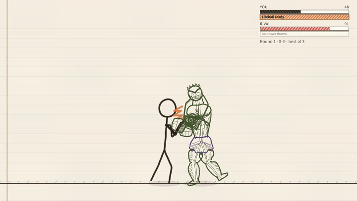

<!--
  The thumbnail below links to the MP4 in this repo (GitHub opens it in its file viewer).
  To get an inline video player in this README instead: edit README.md in the GitHub web editor,
  drag docs/media/notebook-fighters-demo.mp4 into the editor (≤ 100 MB for paid plans, ≤ 10 MB on free
  accounts — re-encode smaller if needed), and GitHub replaces it with a user-attachments URL that renders as a player.
-->
<a href="docs/media/notebook-fighters-demo.mp4">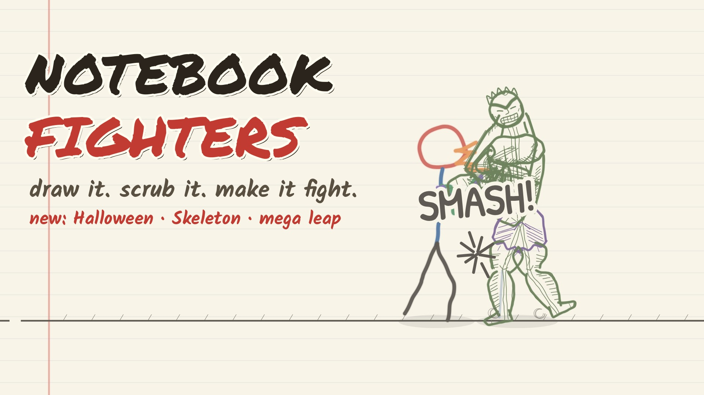</a>

**[▶ Watch the demo](docs/media/notebook-fighters-demo.mp4)** · 66 s · 1080p60 · real gameplay

</div>

---

## Contents

[Features](#features) · [Screenshots](#screenshots) · [Controls](#controls) · [Getting started](#getting-started) · [Architecture](#architecture) · [Testing](#testing) · [Roadmap](#roadmap--known-gaps) · [Credits](#credits) · [License](#license)

## Features

### 🖍️ Draw anything — the recognizer reads it
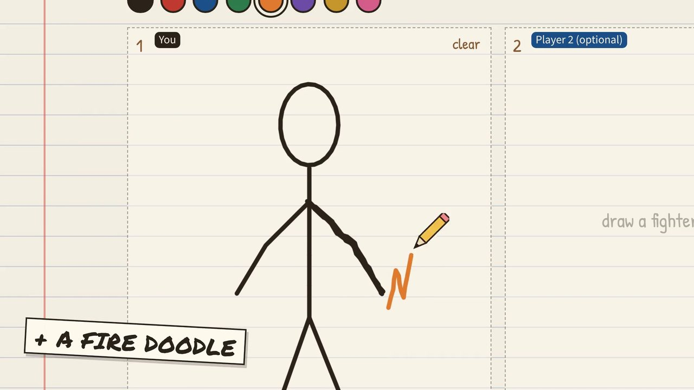

A fully offline reader finds the **head, torso, arms and legs** in your strokes, builds a 15-joint rig and skins *your own ink* to the bones. It also understands **body plans**: biped, four-legged beast (trots in diagonal pairs), blob, snake, car (rolls and pops wheelies), tree, four-armed, even a lone circle. Extras become **tails, capes, hats and weapons**; a sword in the hand gives reach.

Hit **⤢ expand** on a drawing box for a big, near full-screen page: eight coloured pencils, four line weights, an eraser that really cuts strokes apart, undo/redo and clear. It works with mouse, finger and pen. The colours you pick stay on every stroke, in the arena, in replays and in online matches.

<br clear="right">

### 🌑 Scrubbing = strength, neatness = a bonus
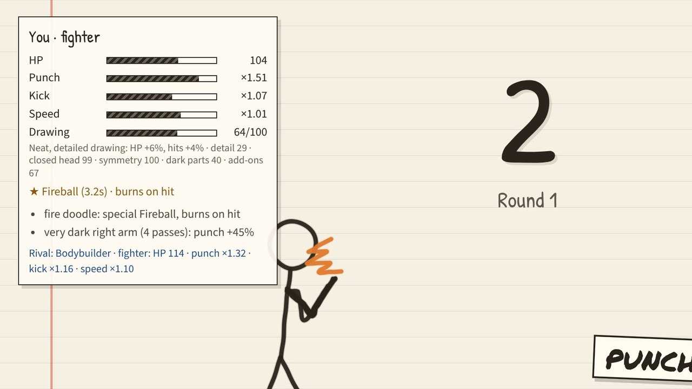

Go over an arm four times and it punches **≈45 % harder**; a dark head or body means more HP — within a scribble budget, so nothing is best at everything. A **drawing-quality score** (detail, closed head, symmetry, dark parts, add-ons) gives a careful drawing up to **+10 % HP / +6 % damage**. The **Fighter Card** explains every number.

<br clear="right">

### ⚡ Draw a power, get a special
Doodle next to your fighter (shape **and** pencil colour count) and press **E / ★**:

| Doodle | Power | Effect | Counters |
|---|---|---|---|
| 🔥 zigzag / flame (red-orange) | **Fireball** | projectile, burns on hit | melts ice ×1.5 |
| 💧 wavy line / droplets (blue) | **Water wave** | wide wave | douses fire ×1.5 |
| ⚡ bolt "Z" (gold) | **Lightning dash** | dash through, stuns | shocks water ×1.5 |
| ❄️ asterisk / snowflake | **Ice shard** | shot that freezes / slows | freezes water ×1.5 |
| 🪽 loops on the back | **Wings** | double jump + dive | — |
| 🛡️ loop held at a hand | **Shield bash** | stops shots cold | — |
| 🦔 spikes along the body | **Spike burst** | hitting you hurts the attacker | — |

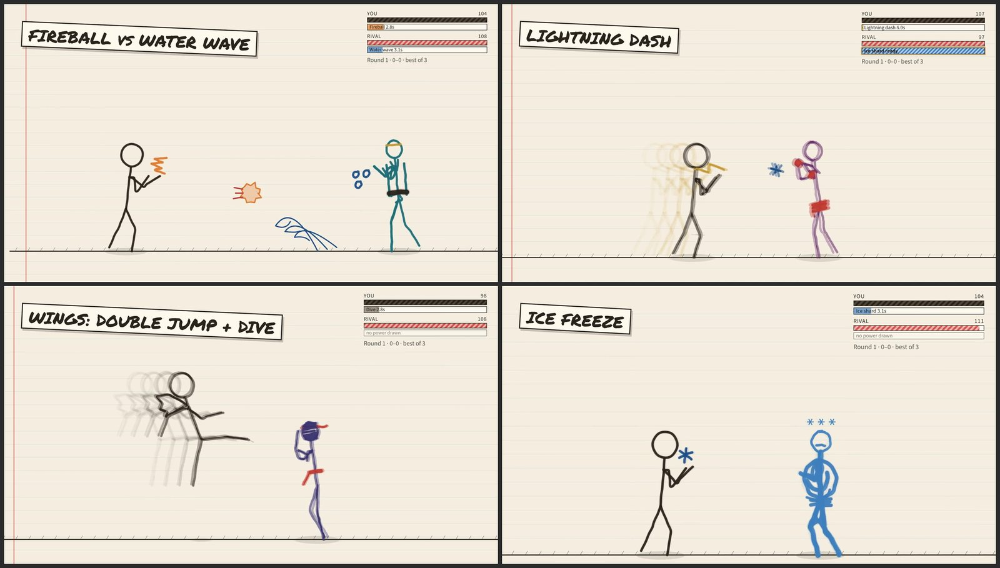

### 💪 Pre-drawn rivals — including a pencil Hulk
Ten hand-drawn computer opponents at real fighter height: **skinny kid, dog, boxer, karate guy, ninja, swordsman, pehelwan, halloween, skeleton and the bodybuilder** — a green, cross-hatched pencil Hulk ≈20 % taller than you, whose heavily-drawn chest and arms really do hit harder. Easy / Normal / Hard pick the tier, and the CPU is balanced with a scripted "casual human" bot (every test drawing wins **41–63 %** on Normal).

The four heavyweights bring **their own special** instead of drawing one to match yours:

| Rival | Special | What it does |
|---|---|---|
| 🎃 **Halloween** (pumpkin head, ragged cloak) | **Throw pumpkin** | a pumpkin lobbed in an arc: it splats for damage and a short stagger |
| 💀 **Skeleton** (skull, ribs, knobbly bones) | **Bone scatter** | falls into a pile of bones (the next hit passes through), then snaps back together a step closer with a bony strike |
| **Pehelwan** | **Ground shake** | a stomp sends a shockwave along the ground: it staggers you if you're standing on it, jump over it; the screen shakes |
| **Bodybuilder** | **Mega leap** | a huge jump across the arena that lands in a smash on anyone near the landing |

The computer uses them when they make sense (a pumpkin from range, the stomp only while you're on the ground, the scatter as an answer to your attack) and not on repeat. Easy waits longer between them (×1.5 the cooldown), Hard the least. Bot win rates per rival (all body types, Easy / Normal / Hard): Halloween 68 / 35 / 42 %, Skeleton 71 / 38 / 27 %, Pehelwan 54 / 19 / 32 %, Bodybuilder 47 / 12 / 17 %: the Hulk is still the hardest.

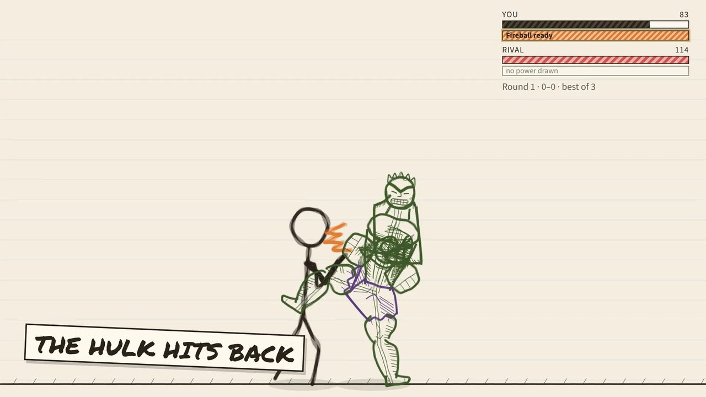 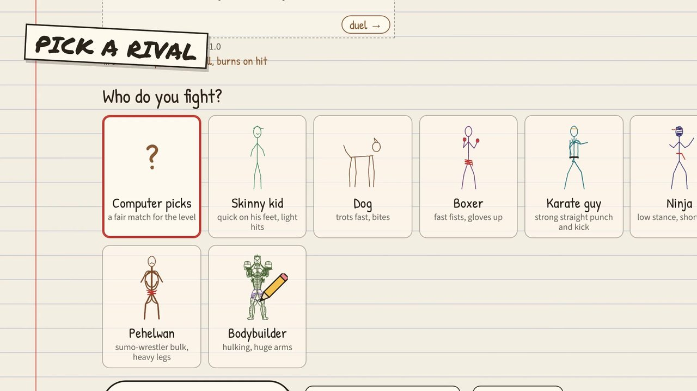

### 👥 Local 2-player
Two kids, one keyboard: P1 on WASD, P2 on the arrows — each with their own drawing. On a touch screen each player gets their own pads. Best-of-3 with instant rematches.

### 🌐 Online rooms with deterministic lockstep
**Create room → share the 6-letter code or `/r/CODE` link.** Each room is a [Cloudflare Durable Object](https://developers.cloudflare.com/durable-objects/) that relays inputs only; both browsers run the same deterministic sim (seeded CPU dice, deterministic Rapier build) with a small input delay, a checksum every second, and seat-holding reconnects (60 s) that rebuild from the input log. Inputs travel 2–4 frames per message, so a player sends ≈15–30 messages a second. Tested at 100 ± 30 ms of lag: **0 desyncs**.

### 📶 Play nearby — no internet
Two phones, one hotspot, two QR codes. One phone turns on its **hotspot** (mobile data not needed) and the other joins it; or both sit on any Wi-Fi, even one with no internet. On [`/nearby`](https://notebook-fighters.coollagers.workers.dev/nearby) the host taps **Create nearby room** and shows a QR, the friend taps **Join nearby** and scans it, then shows an answer QR that the host scans back. Each step also has a **copy / paste code** fallback.

The phones talk over a direct **WebRTC data channel** with no server, not even the game's: no STUN or TURN, only the phones' addresses on the shared network. The host's phone runs the room itself (the same lobby, drawing exchange, Accept / Decline, input-delay pick from the measured round trip, checksums every second and desync check as an online room), and the fight is the same lockstep engine. If the link drops, both phones say **Connection lost** with Rematch / Back. Browsers can't do phone-to-phone Bluetooth, so the hotspot does that job.

The site is also an **installable app that works offline**: after one visit a service worker keeps every page, script, sound and font, so the computer, 2-player and play nearby all work with no connection. The QR codes are drawn and read with bundled libraries ([qrcode-generator](https://github.com/kazuhikoarase/qrcode-generator), [jsQR](https://github.com/cozmo/jsQR)), with no CDN. Camera scanning uses the browser's `BarcodeDetector` where it exists (Chrome on Android) and jsQR elsewhere (iPhone Safari, Firefox, desktop Chrome on Windows / Linux).

### 💥 Rapier ragdoll KOs + slow-mo replay
Knockouts hand the rig to a **Rapier2D (deterministic)** ragdoll — the dog folds with legs splayed, the car rolls onto its roof. Hits **freeze** for a few frames by weight, the victim squashes, the camera punches in, the KO **auto-replays in slow motion**, and **Save clip** exports the last 5 s as WebM.

### 🔊 Real, layered sound effects
52 **Kenney CC0** sounds, layered per hit: a swish on the swing-start frame, one of 5 punch/kick impacts on the exact contact frame (no repeats, ±4 % pitch), deeper thumps for the Hulk, block clacks, a KO stack (hit + boom + bell + body thud), and a sound for every power, the countdown and the FIGHT! bell. Falls back to synthesized audio if a file fails.

### ❓ How to play, built in
A **? How to play** button on the notebook and in every fight (it pauses a fight against the computer or a local duel), and it opens by itself on your first visit. Eight short pages with real screenshots of the game and a label on every button: drawing, what your drawing does (the powers list comes straight from the sim), the computer, 2 players, rooms, play nearby, the fight controls and the HUD. Phones and tablets get the **touch** version (joystick and buttons), computers the **keyboard** version (with gamepad notes); either can be picked at the top. Next / Back, swipe, ← → and Esc; the pictures are small WebP files that the service worker keeps for offline play.

### 📱 Phone, tablet, gamepad — controls per device
Laptops show **only the keyboard legend**; phones and tablets show **only the touch pads** (thumb joystick + compact buttons, multi-touch, no scroll/zoom); a touchscreen laptop switches to whatever you actually use. Standard **gamepads** work everywhere. Rendered at full device-pixel resolution, so lines stay crisp.

## Screenshots

| | | |
|:---:|:---:|:---:|
| <br>**Draw & scrub** | <br>**Fighter Card** | <br>**The Hulk hits back** |
| <br>**Powers & counters** | 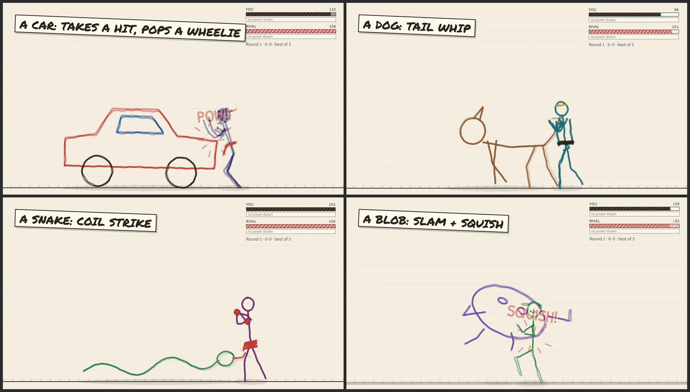<br>**Car, dog, snake, blob** | 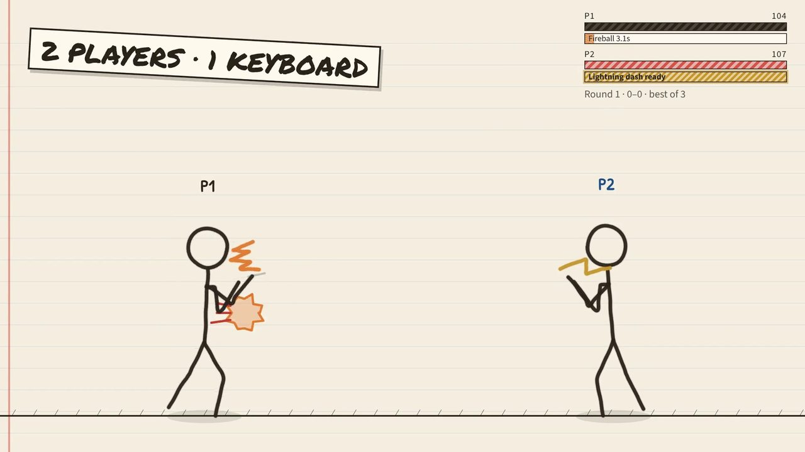<br>**2 players · 1 keyboard** |
| 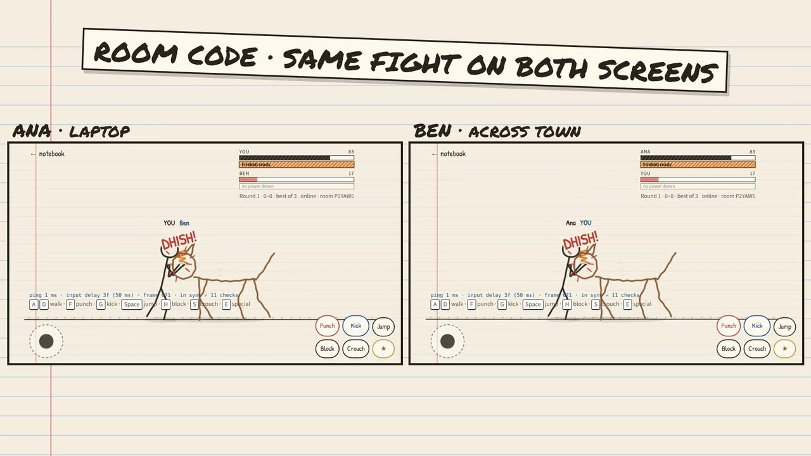<br>**Online, side by side** | 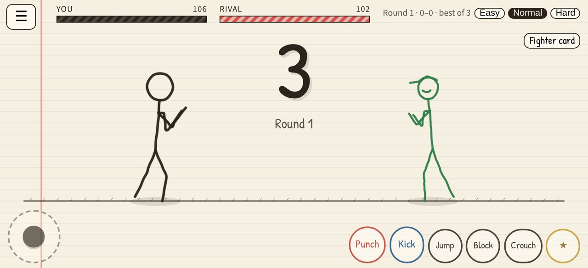<br>**Phone touch controls** | 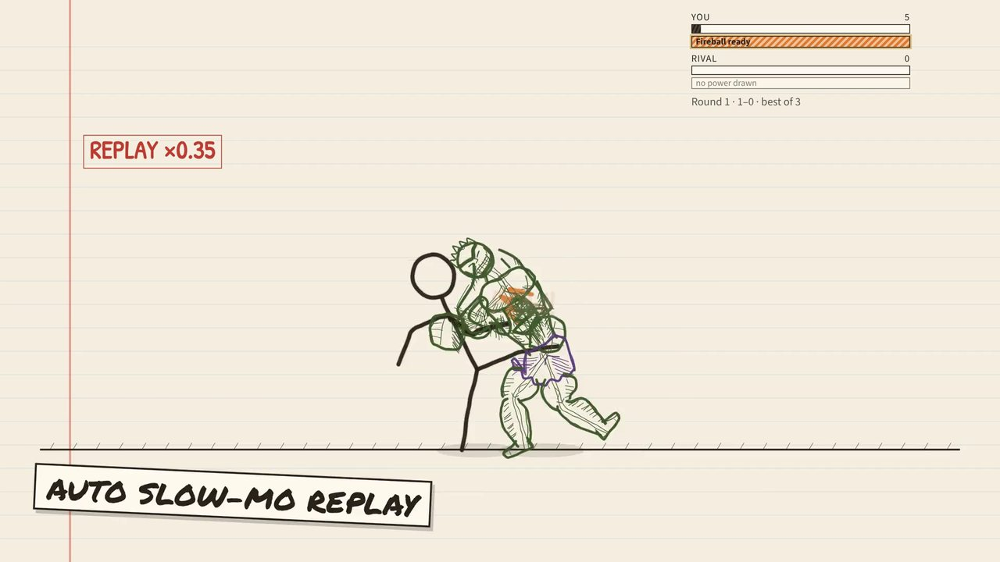<br>**Slow-mo KO replay** |

## Controls

**Keyboard — 1 player** (either hand works)

| Move | Keys |
|---|---|
| Walk | `A` `D` / `←` `→` |
| Jump | `W` / `Space` / `↑` |
| Crouch | `S` / `↓` |
| Punch · Kick | `F` · `G` (or `J` · `K`) |
| Block | `H` / `Shift` |
| Special ★ | `E` (or `L`) |
| Next round / rematch | `R` |

**Keyboard — 2 players**

| | Player 1 | Player 2 |
|---|---|---|
| Walk | `A` `D` | `←` `→` |
| Jump · Crouch | `W` · `S` | `↑` · `↓` |
| Punch · Kick · Block | `F` · `G` · `H` | `J` · `K` · `L` |
| Special ★ | `E` | `;` |

**Touch** (phones & tablets)

| Control | Action |
|---|---|
| Left-thumb joystick | walk · push up to jump · down to crouch |
| **Punch · Kick · Jump · Block · Crouch · ★** | right-thumb buttons (multi-touch) |
| ☰ | menu: sound, engine, Save clip, tuners, back to notebook |
| Tap the banner | next round / rematch |

**Gamepad** (standard mapping — pad 1 → P1, pad 2 → P2)

| Control | Action |
|---|---|
| Left stick / D-pad | walk · up = jump · down = crouch |
| A | jump |
| X · Y | punch · kick |
| B / LB / LT | block |
| RB / RT | special ★ |

## Getting started

Requires **Node 22+** (Wrangler needs it) and **pnpm 10** (`corepack enable`).

```bash
pnpm i            # install the workspace
pnpm worker:dev   # build the site, then run the whole thing locally → http://localhost:8787
                  #   (Wrangler + Miniflare: static site + online rooms, exactly as deployed)
pnpm dev          # or: Next.js dev server with hot reload → http://localhost:3100
```

| URL | What |
|---|---|
| `http://localhost:3100/` | the notebook: draw your fighter (and optional P2), pick a rival |
| `/play` | fight the computer · `?level=easy\|normal\|hard` · `?rival=bodybuilder` |
| `/play?mode=2p` | two players, one keyboard |
| `/online` · `/r/CODE` | create / join an online room (needs the Worker: `pnpm worker:dev`) |
| `?renderer=pixi` · `?physics=classic` | opt into the PixiJS renderer · use the classic verlet KO |

The online page talks to the Worker that served it (`/api/rooms`, `wss://<host>/api/rooms/CODE/ws`). Under `pnpm dev` there is no Worker on :3100, so run `pnpm worker:dev` alongside and start Next with `NEXT_PUBLIC_NF_SERVER=http://localhost:8787 pnpm dev` (or add `?server=http://localhost:8787` to `/online`).

## Deploy (Cloudflare Workers, free plan)

The whole game is **one Cloudflare Worker** (`apps/worker`): the static Next.js export is served by [Workers Static Assets](https://developers.cloudflare.com/workers/static-assets/), and online rooms run on a SQLite-backed [Durable Object](https://developers.cloudflare.com/durable-objects/) — the kind included in the **Workers Free** plan.

```bash
pnpm --filter @nf/worker exec wrangler login   # once
pnpm run deploy                                # next build → apps/web/out, then wrangler deploy
```

(`pnpm run deploy`, not `pnpm deploy` — that name is a built-in pnpm command.) The game is then live at `https://notebook-fighters.<your-subdomain>.workers.dev`; add a custom domain in the Cloudflare dashboard if you like.

**Deploying from GitHub with Cloudflare Workers Builds:** connect the repo to a Worker named `notebook-fighters`, set the build command to `pnpm run build`, and set the deploy command to `cd apps/worker && npx wrangler deploy`. The default `npx wrangler deploy` from the repo root also works, because the root `wrangler.jsonc` mirrors `apps/worker/wrangler.jsonc` (keep the two in sync).

| Route | What |
|---|---|
| `GET /api/health` | `{ ok: true }` |
| `POST /api/rooms` | claims a fresh 6-character room code |
| `GET /api/rooms/:code` | that room's counters (phase, frames, checksums, desyncs, reconnects) |
| `GET /api/rooms/:code/ws` | WebSocket into the room's Durable Object (`idFromName(code)`) |
| `/r/:code` | 302 → `/online?join=CODE` |
| everything else | the static site (`404.html` when nothing matches) |

**Cost:** nothing on the free plan — over the daily limits requests simply fail until the next day (the online page then says "Online is busy right now" and offers the computer or a 2-player game on the same device; the Worker answers a JSON `503 {"error":"busy"}` instead of an error page); you're only billed if you upgrade. Rooms use the WebSocket Hibernation API (no timers, alarms for the 60 s seat hold, runtime-answered keepalives), so a room waiting for a friend costs no duration, and incoming WebSocket messages bill 20:1. With batching a 1-minute match is ≈1,800–3,600 messages ≈ 90–180 billed requests, so the 100,000 free requests a day cover roughly **550–1,100 one-minute matches a day**.

## Architecture

```
notebook-fighters/
├── apps/
│   ├── web/             Next.js app: notebook (/), duel (/play), online (/online, /r/[code]), play nearby (/nearby), service worker
│   │   ├── app/play/      fight page, touch pads, gamepad, input-mode, layered SFX
│   │   └── public/sfx/    52 Kenney CC0 sounds (.ogg + .m4a) + CREDITS.md
│   └── worker/          the Cloudflare Worker: static assets + Room Durable Object + headless online test
├── packages/
│   ├── shared/          types, tuning constants, net protocol
│   ├── sim/             the game: rig reader, skinning, stats, powers, anim, AI, Rapier KO, lockstep
│   │   └── test/          headless tests + balance bot
│   └── render/          Canvas2D renderer (default) + PixiJS backend
├── e2e/                 Playwright browser checks (desktop, phones, tablets, online)
└── docs/                design plan, iteration log, media
```

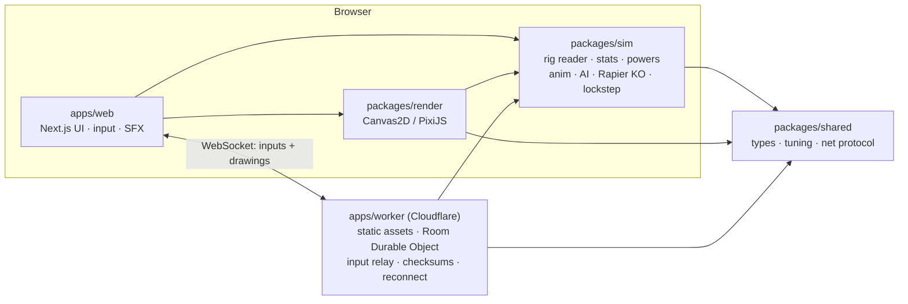

The sim is pure TypeScript and fully deterministic (fixed step, seeded randomness, deterministic Rapier), so the same inputs replay the same fight — which is what makes lockstep online, KO replays and headless balance testing possible. The packages are consumed as TS source via `transpilePackages`.

## Testing

```bash
pnpm typecheck      # tsc --noEmit in every workspace package
pnpm test           # 17 headless sim suites: rig, shapes, recognize, duel, ko, powers, specials, signatures,
                    #   stats, edge, reach, versus, scribble, rivalcheck, rapier, roster, nearby
pnpm --filter @nf/sim test:duel     # …or any one suite
pnpm --filter @nf/sim balance       # casual-human bot vs the CPU on every level (win-rate table)
pnpm --filter @nf/sim rivals        # the bot vs every rival on every level; the Hulk must stay the hardest
pnpm test:online    # headless 2-client lockstep against the Worker: lag, drop + reconnect, page reload
                    #   (needs pnpm worker:dev; BASE=https://… to test a deploy)
```

Browser checks (Playwright, against a running `pnpm dev`; `online.mjs` against `pnpm worker:dev`) live in [`e2e/`](e2e/README.md): per-device controls, phone/tablet layouts, Fighter Card, powers, 2P, game feel, SFX timing, a two-browser online match, and `nearby.mjs`: offline pages from the service worker, then two browsers pairing by paste and by camera-scanned QR with the server shut down, playing full matches with 0 desyncs.

✅ **Latest full regression: all green** — `tsc` ×5 packages, 15 sim suites, `next build`, and e2e controls, sfx, mobile ×6 devices, card, powers, twop, human, feel and online (log in [`docs/ITERATIONS.md`](docs/ITERATIONS.md)).

## Roadmap & known gaps

- **Balance outliers:** on Easy the car and snake win ≈99 %; on Hard lightning (≈40 %) and four-armed (≈37 %) are a bit strong, shield and spikes sit near the 15 % floor. The Hulk is the toughest rival (≈19 % bot wins on Normal).
- **Reader edge cases:** a car drawn with its cabin dead-centre keeps its drawn direction; a tree fights as a big-headed figure; no sword parry yet.
- **PixiJS renderer** is opt-in (`?renderer=pixi`) — on a GPU-less box it ran 36–52 fps vs a steady 60 for Canvas2D; needs measuring on real GPUs.
- **Play nearby** is tested in headless Chromium over loopback, not yet on two real phones. Chrome hides a phone's address behind an mDNS `.local` name until the page has camera permission; that resolves on most hotspots, but a network that blocks multicast could stop the phones finding each other. The QR is dense (about 470 characters), so hold the phones close.
- Online play adds a fixed input delay (≈0.17 s at 100 ms ping); rollback netcode would hide it.
- Real-player playtests on phones; the "you drew fire, I draw water" back-and-forth from the [design plan](docs/notebook-fighters-plan.md).

The full build history — 11+ iterations of fixes, balance numbers and test runs — is in [`docs/ITERATIONS.md`](docs/ITERATIONS.md).

## Credits

- **Sound effects:** [Kenney](https://www.kenney.nl) — Impact Sounds, Foley Sounds, RPG Audio, Sci-Fi Sounds, Digital Audio, Interface Sounds and Music Jingles, released under **[CC0 1.0](https://creativecommons.org/publicdomain/zero/1.0/)** (public domain). Every file and its source is listed in [`apps/web/public/sfx/CREDITS.md`](apps/web/public/sfx/CREDITS.md). Thank you, Kenney!
- Built with [Next.js](https://nextjs.org), [React](https://react.dev), [Cloudflare Workers + Durable Objects](https://developers.cloudflare.com/durable-objects/), [Rapier](https://rapier.rs) and [PixiJS](https://pixijs.com).

## License

Code: **[MIT](LICENSE)** © 2026 **Shashank Kumar Rathour** ([@Happyesss](https://github.com/Happyesss)). A personal open-source project.
Sound effects: **CC0 1.0** by Kenney — not covered by the MIT licence; see [CREDITS](apps/web/public/sfx/CREDITS.md).
