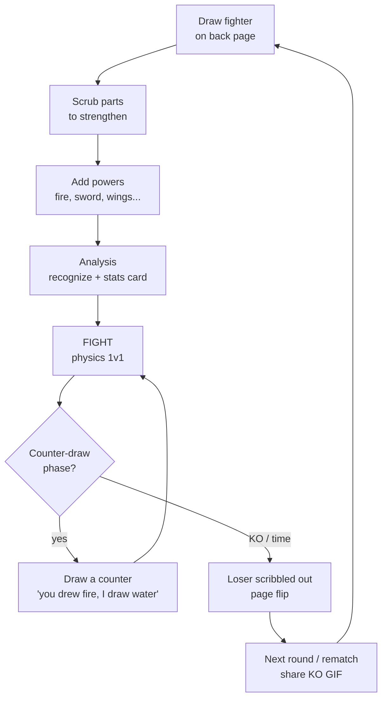
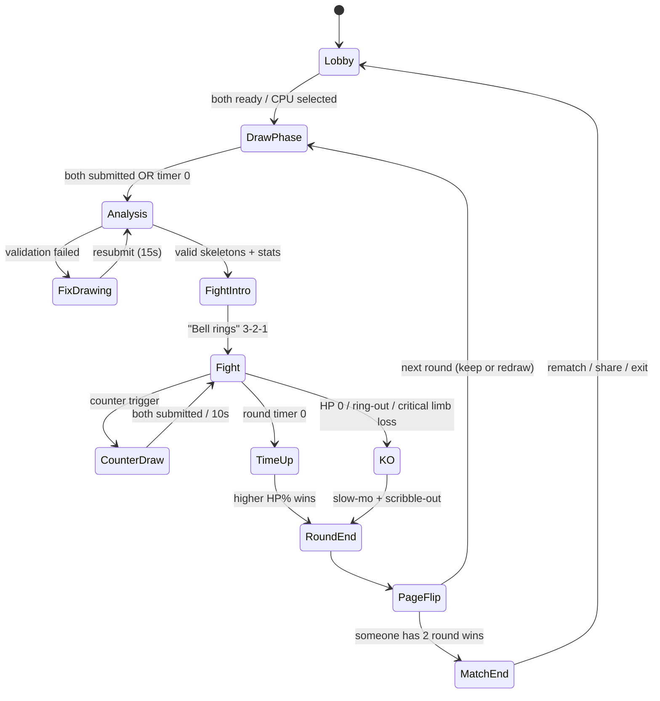
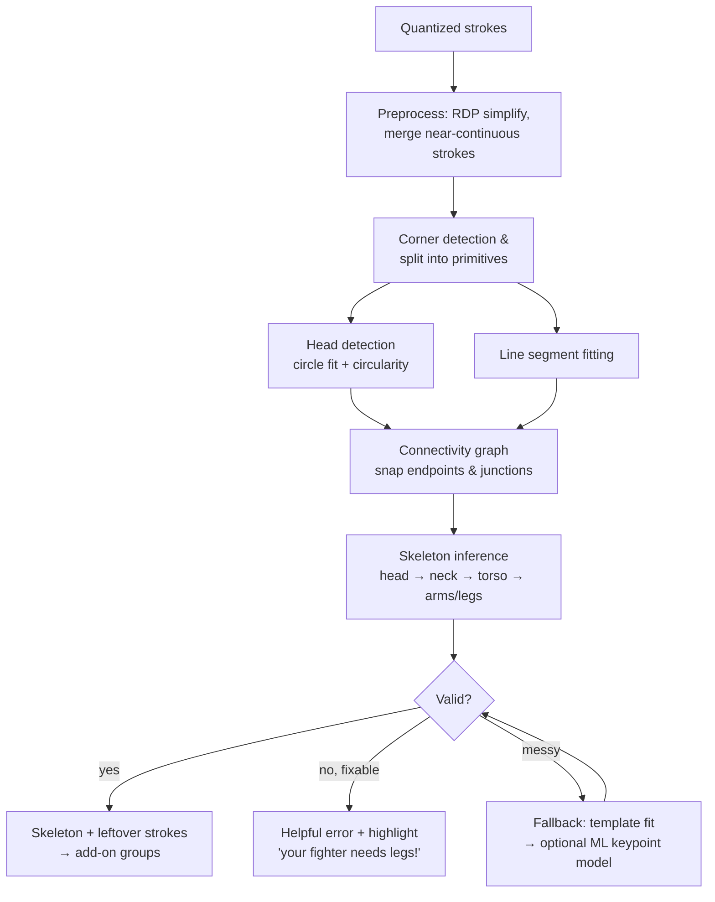
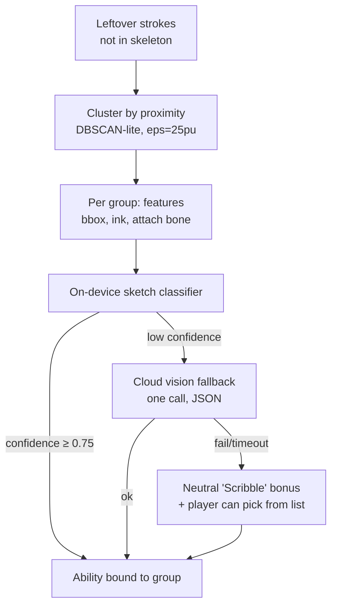
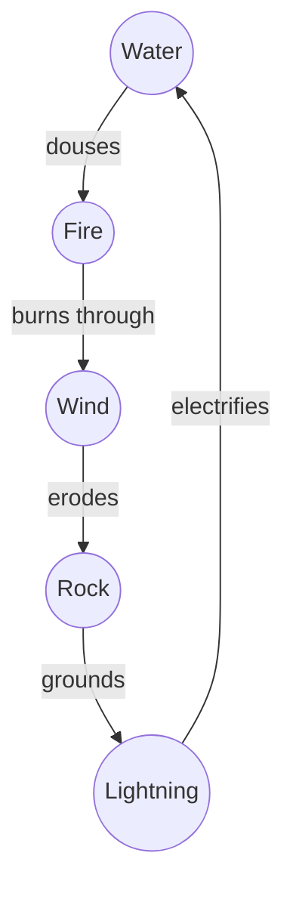
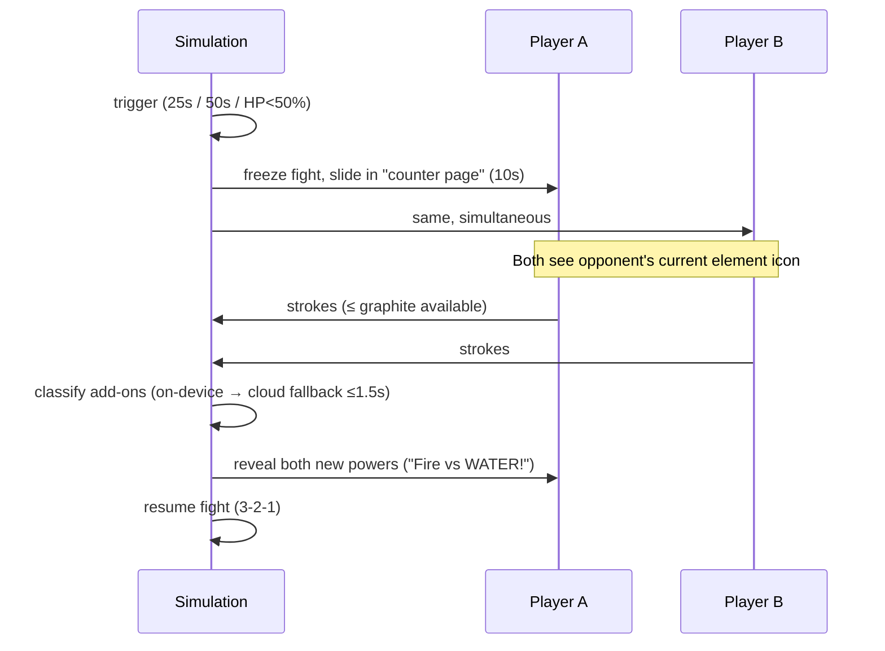
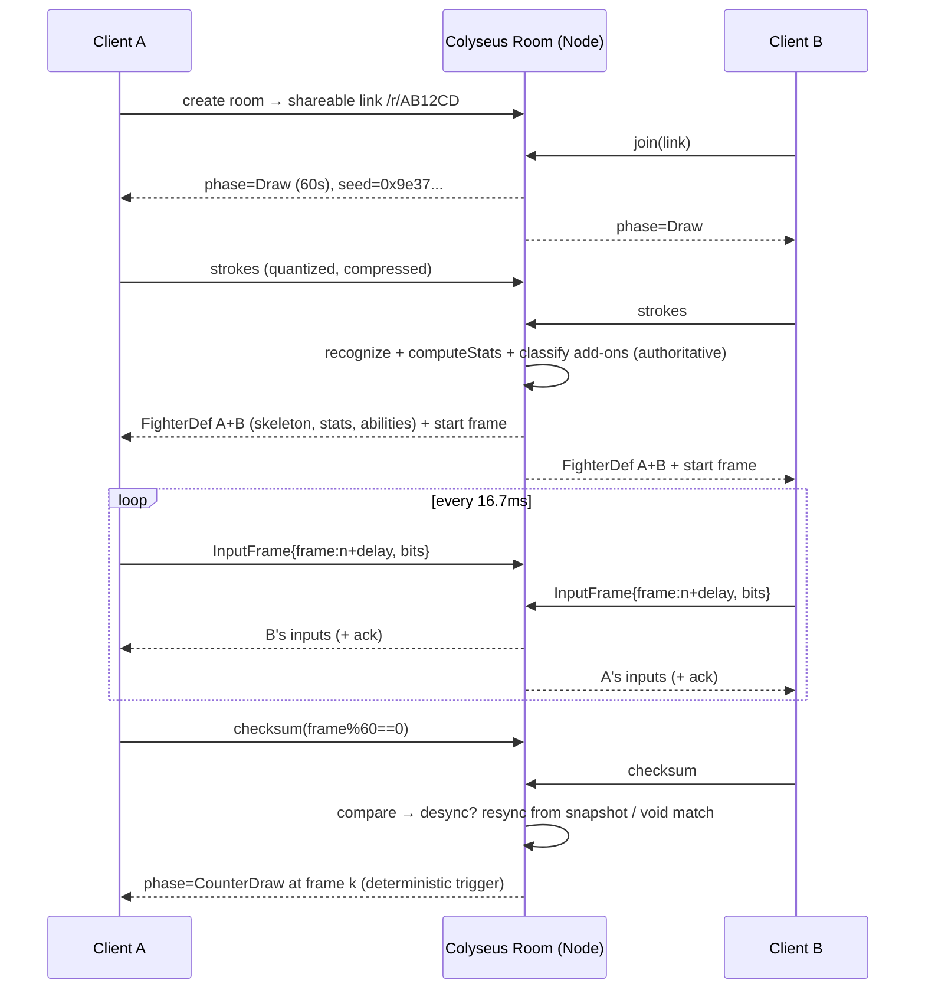
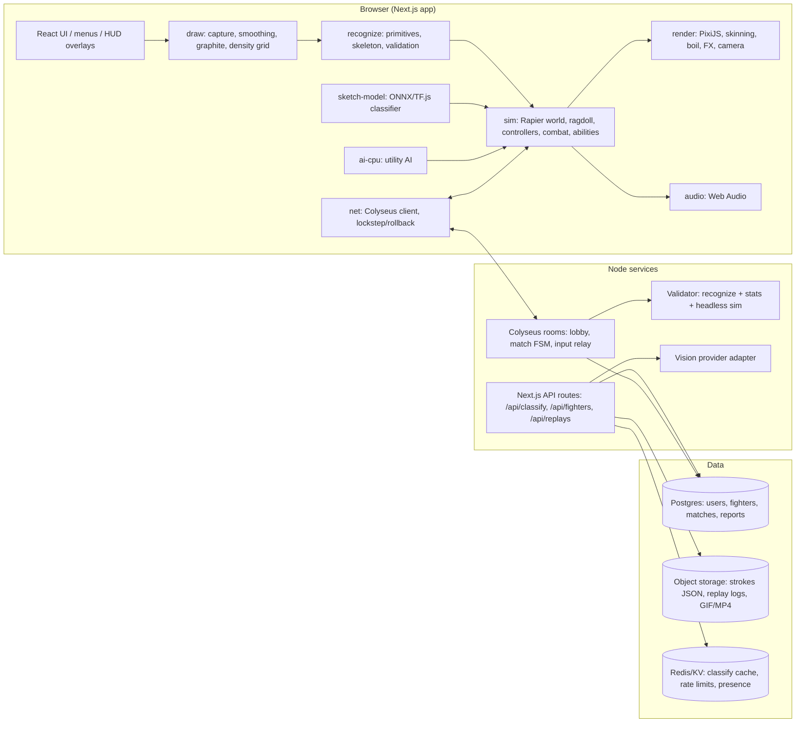
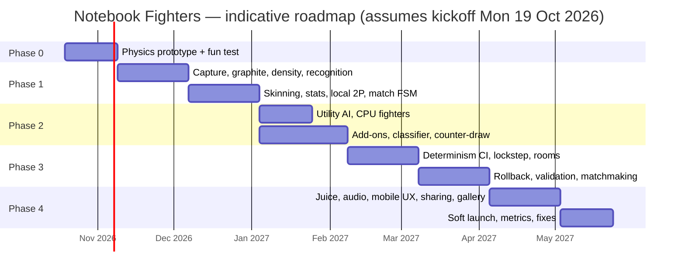

<div class="cover">

# Notebook Fighters
## Game Design + Technical Plan (v1.0)

**Draw your fighter on the back page. Scrub it darker to make it stronger. Then make it fight — with real physics.**

| | |
|---|---|
| **Prepared for** | Shashank Rathour (Founder/CTO) and the core dev team |
| **Date** | 9 October 2026 |
| **Platform** | Browser (desktop + mobile web), Next.js + TypeScript |
| **Status** | Pre-production plan — Phase 0 ready to start |

</div>

<div class="pagebreak"></div>

## Table of Contents

1. Vision, pillars, audience & differentiation
2. Core loop, modes & match flow
3. Drawing system
4. Stick-figure recognition
5. Stats model
6. Physics & active ragdoll
7. Rendering & art direction
8. Powers / add-ons system
9. AI: sketch recognition & CPU opponent
10. Multiplayer & netcode
11. Architecture, repo & key interfaces
12. Audio, feel, accessibility, mobile UX & performance
13. Social, virality & monetization
14. Roadmap & milestones
15. Risks, open questions & testing plan
16. Appendix: Glossary, reference constants

> **How to read this document.** Every section ends with concrete decisions ("**Decision:**") so the team can start building without re-litigating. Formulas and constants are *starting values* to tune in playtests, not final numbers. TypeScript snippets are illustrative — check them against current library docs (especially Rapier, PixiJS and Colyseus APIs, which evolve).

---

# 1. Vision, Pillars, Audience & Differentiation

## 1.1 The one-line pitch

> *Remember the back pages of your ruled notebook? Circle head, line body, two arms, two legs — scrub over the arms until they shine because "now he punches harder", add fire, and fight your bench-mate's guy. Notebook Fighters turns that exact ritual into a physics fighting game.*

## 1.2 Working title & alternatives

| Name | Flavour | Notes |
|---|---|---|
| **Notebook Fighters** (working title) | Universal, instantly clear | Easy to search; works globally |
| **Rough Copy Rumble** | The "rough copy" every Indian student had | Strongest nostalgia hook for Indian audience; alliterative |
| **Last Page Ladai** | *Ladai* = fight (Hindi) | Fun, very desi; less clear internationally |
| **Pencil Pehelwan** | *Pehelwan* = wrestler | Great mascot potential (a stick-man wrestler) |
| **Back Bench Brawl** | Back-benchers doodling during class | Good for marketing copy and events |

**Recommendation:** ship as **Notebook Fighters** globally with a *"Rough Copy Rumble"* mode/event name for Indian marketing — or test both on store/landing pages before committing (see §13). Run a trademark/domain check before final choice.

## 1.3 Design pillars

1. **Your drawing *is* the fighter.** We never replace the player's art. Their wobbly pencil lines are skinned onto the physics bones and fight exactly as drawn.
2. **Scrubbing = strength, transparently.** Going over a part makes it darker and stronger. The rule is deterministic, visible, and explainable in one sentence — no hidden AI judgement on power.
3. **Real physics, real limbs.** Every punch is a swinging arm, every kick a swinging leg, every KO a ragdoll collapse. Funny emergent moments come from physics, not scripted animation.
4. **One clear, readable 1v1.** Two fighters, one page, big silhouettes. No clutter, no armies, no story.
5. **"You drew fire, I draw water."** The counter-draw phase brings back the childhood back-and-forth of escalating imaginary powers.
6. **Works offline, works when AI is down.** AI only *classifies add-ons* and *drives the CPU*. Core game = deterministic code.

## 1.4 Target audience

| Segment | Why they care | Design implication |
|---|---|---|
| **Indian 18–35 ("90s/2000s school kids")** | Pure nostalgia for back-page stick-man fights | Ruled paper, red margin, classroom SFX, desi humour |
| **Teens / students (13–18)** | Playing with friends on one phone/laptop; shareable funny KOs | Local 2P first, fast rounds, share clips |
| **Casual physics-game fans (global)** | Ragdoll comedy (genre of "wobbly" games) | Strong physics feel, replay GIFs |
| **Creators / streamers** | Viewers draw fighters for them; highly clippable | Room links, gallery, fighter cards |

Age rating: aim for a general/teen audience; user-generated drawings require moderation of anything shared publicly (§9.4).

## 1.5 Competitive landscape (qualitative)

| Title | What it does well | Gap we exploit |
|---|---|---|
| **Kritzel Krieg** | Draw-to-play war concept | Tiny marching units, no visible hand/limb movement, no real physics, cluttered visuals |
| **Draw a Stickman: EPIC (series, incl. EPIC 3)** | Drawing as a tool within an adventure | Story/adventure game; not a 1v1 fighter |
| **Draw Creatures** (10M+ downloads) | Proves mass appeal of "your drawing comes to life" | Creature battles, not physics-driven stick-figure combat |
| **Scribble Fighters** | Doodle-style fighting theme | Art is a skin, not *your* drawing driving physics |
| **Art Attack** | Drawing-centric party feel | Not a physics brawler with stat-from-drawing |
| **Rakugaki Beast** | Doodles turned into beasts | Monster focus; not limb-level physics combat |
| **AI Pixel Battle** | AI judges/creates fighters | Power decided by opaque AI; we make power transparent (scrubbing) |
| **Doodle Dice Monsters** | Doodle + chance-based combat | Dice/turn logic vs our real-time physics |

> Note: competitor descriptions are qualitative impressions for positioning. The only quantitative claim used is Draw Creatures' 10M+ downloads. Re-verify before external use.

**Our unique combination:** (a) the player's *own strokes* animated on (b) a *real active ragdoll* with (c) *transparent overdraw-based stats* in (d) a *readable 1v1* with (e) a *mid-fight counter-draw* mechanic and (f) a culturally specific notebook aesthetic.

**Decision:** Pillars 1–6 are the filter for every feature. If a feature doesn't serve a pillar, it waits.

---

# 2. Core Game Loop, Modes & Match Flow

## 2.1 Core loop



**Session target:** a full match (best of 3) in **4–7 minutes**; a single round fight **45–90 s**.

## 2.2 Modes (ship order)

| Mode | Phase | Description |
|---|---|---|
| **Local 2P (same screen)** | 1 | Both draw (sequentially on mobile, side-by-side on desktop), then fight on one keyboard / split touch controls |
| **Vs CPU** | 2 | CPU "draws" its fighter live (animated strokes from templates), utility AI fights; 3–4 difficulty levels |
| **Practice / Sandbox** | 1 | Punching-bag dummy, tweak your fighter, see stats change live |
| **Online 1v1 (room link)** | 3 | Share link → friend joins → draw simultaneously → fight |
| **Online quick match** | 3+ | Matchmaking by rough skill; same rules |
| **Gallery fight** | 4 | Fight community-made fighters controlled by CPU |

## 2.3 Match flow state machine



## 2.4 Round & timer rules (starting values)

| Rule | Value | Rationale |
|---|---|---|
| Match format | Best of 3 rounds | Short, allows comeback |
| Initial draw phase | 60 s (Casual: 90 s) | Enough to draw + scrub; prevents stalling |
| Analysis | 2–3 s ("pencil-sharpening" animation) | Hides cloud classification latency |
| Fix-drawing window | 15 s, max 2 times | Helpful, not punishing |
| Round fight time | 75 s | Keeps rounds snappy |
| Counter-draw triggers | at 25 s and 50 s of fight time, **or** when a fighter drops below 50% HP (once per round) | Predictable rhythm + catch-up beat |
| Counter-draw duration | 10 s, simultaneous | Fast, keeps tension |
| Win condition (round) | KO, ring-out (off the page), or higher HP% at time up | Clear and readable |
| Between rounds | Winner keeps fighter (can touch up for 15 s); loser fully redraws or touches up for 30 s | The childhood "draw a stronger one" loop; slight catch-up |
| Draw rule on time-up tie | Sudden death: 15 s, first clean hit wins | Prevents ties |

**Decision:** Implement the flow as an explicit, serializable finite state machine (`MatchPhase` enum + transition table) shared by client, CPU mode and server (§11).

---
# 3. Drawing System

## 3.1 Canvas & coordinate system

- The **drawing page** is a logical 1000 × 1400 "paper units" (pu) portrait area (mobile) or a 1000 × 1000 square per fighter (desktop side-by-side). All strokes are stored in **paper units**, never screen pixels, so the same drawing produces the same stats on every device.
- A **figure box** (dashed pencil rectangle, ~600 × 900 pu) limits where the fighter may be drawn. Strokes outside the box are clipped (anti-cheat on size).
- **Quantization:** stored points are rounded to 0.5 pu, timestamps to 1 ms, pressure to 1/255. This makes stroke data compact and makes stats reproducible bit-for-bit on server and client.

## 3.2 Input capture

Use **Pointer Events** (`pointerdown/move/up`) with `getCoalescedEvents()` to recover high-frequency samples, `touch-action: none` on the canvas, and `setPointerCapture()`.

```ts
export interface StrokePoint { x: number; y: number; t: number; p: number } // pu, ms, 0..1
export interface Stroke {
  id: string;
  tool: 'pencil' | 'eraser';
  points: StrokePoint[];     // raw, quantized
  simplified?: StrokePoint[];// after RDP (for recognition)
  startedAt: number;
}

function attachCapture(canvas: HTMLCanvasElement, toPaper: (x: number, y: number) => [number, number],
                       onStroke: (s: Stroke) => void) {
  let cur: Stroke | null = null;
  canvas.style.touchAction = 'none';
  canvas.addEventListener('pointerdown', e => {
    canvas.setPointerCapture(e.pointerId);
    cur = { id: crypto.randomUUID(), tool: e.button === 5 ? 'eraser' : 'pencil', points: [], startedAt: e.timeStamp };
    push(e);
  });
  canvas.addEventListener('pointermove', e => {
    if (!cur) return;
    for (const ce of (e.getCoalescedEvents?.() ?? [e])) push(ce);
  });
  canvas.addEventListener('pointerup', () => { if (cur && cur.points.length > 1) onStroke(cur); cur = null; });

  function push(e: PointerEvent) {
    const [x, y] = toPaper(e.offsetX, e.offsetY);
    // Mouse reports 0.5 when pressed; touch often reports 0 or 1 — normalize.
    const p = e.pointerType === 'pen' ? e.pressure : 0.5;
    cur!.points.push({ x: q(x, 0.5), y: q(y, 0.5), t: Math.round(e.timeStamp - cur!.startedAt), p: q(p, 1 / 255) });
  }
}
const q = (v: number, step: number) => Math.round(v / step) * step;
```

> **Important design rule:** most phones and mice have **no real pressure**. Therefore *strength comes from overdraw (passes), not pressure*. Pressure (when a stylus provides it) only changes stroke *width/darkness of a single pass* within a small range (±15%) so stylus users are not advantaged.

## 3.3 Smoothing & simplification

Two separate representations:

| Representation | Algorithm | Used for |
|---|---|---|
| **Render path** | Distance-based resampling (every 1.5 pu) + **centripetal Catmull–Rom** spline | Pretty, smooth pencil rendering |
| **Recognition path** | **Ramer–Douglas–Peucker** (ε ≈ 4 pu) | Corner detection, line fitting, circle fitting |

```ts
// Ramer–Douglas–Peucker (iterative to avoid deep recursion on long strokes)
export function rdp(pts: Vec2[], eps: number): Vec2[] {
  if (pts.length < 3) return pts.slice();
  const keep = new Uint8Array(pts.length); keep[0] = keep[pts.length - 1] = 1;
  const stack: [number, number][] = [[0, pts.length - 1]];
  while (stack.length) {
    const [a, b] = stack.pop()!;
    let maxD = 0, idx = -1;
    for (let i = a + 1; i < b; i++) {
      const d = distPointSegment(pts[i], pts[a], pts[b]);
      if (d > maxD) { maxD = d; idx = i; }
    }
    if (maxD > eps && idx > 0) { keep[idx] = 1; stack.push([a, idx], [idx, b]); }
  }
  return pts.filter((_, i) => keep[i]);
}

// Centripetal Catmull–Rom segment (alpha = 0.5) between p1 and p2
export function catmullRom(p0: Vec2, p1: Vec2, p2: Vec2, p3: Vec2, steps = 8): Vec2[] {
  const tj = (ti: number, a: Vec2, b: Vec2) => ti + Math.hypot(b.x - a.x, b.y - a.y) ** 0.5;
  const t0 = 0, t1 = tj(t0, p0, p1), t2 = tj(t1, p1, p2), t3 = tj(t2, p2, p3);
  const out: Vec2[] = [];
  for (let i = 0; i <= steps; i++) {
    const t = t1 + (t2 - t1) * (i / steps);
    const A1 = lerpT(p0, p1, t0, t1, t), A2 = lerpT(p1, p2, t1, t2, t), A3 = lerpT(p2, p3, t2, t3, t);
    const B1 = lerpT(A1, A2, t0, t2, t), B2 = lerpT(A2, A3, t1, t3, t);
    out.push(lerpT(B1, B2, t1, t2, t));
  }
  return out;
}
const lerpT = (a: Vec2, b: Vec2, ta: number, tb: number, t: number) => {
  const k = tb === ta ? 0 : (t - ta) / (tb - ta);
  return { x: a.x + (b.x - a.x) * k, y: a.y + (b.y - a.y) * k };
};
```

## 3.4 Graphite rendering (stamp brush + accumulation buffer)

Real pencil darkens *non-linearly*: each pass fills more of the paper's tooth until it saturates and gets a sheen. We model this with a **stamp brush** writing into a **float accumulation buffer**.

```
 Stroke path ──resample every 0.35×brushSize──► stamps
     each stamp: grain-textured disc (8–12 px), alpha a ≈ 0.18 × pressureMod
     accumulate:  A_new = A_old + a × (1 − A_old) × grain(x,y)     (saturating "over")
 Display:  colour = mix(paper, graphite, A) ; add sheen when A > 0.8
```

- **Accumulation buffer:** `Float32Array` (or an RGBA16F/R32F WebGL render target) at **density-grid resolution** of 2 pu/cell → 500 × 700 cells for a full page (~1.4 MB as Float32; fine).
- **Paper grain:** a tileable noise texture `grain(x,y) ∈ [0.6, 1]` so the first pass looks grainy and later passes fill in — exactly the "scrubbed" look.
- **Live display:** render stamps via PixiJS into a `RenderTexture` with a custom shader (or Canvas2D fallback). The *numeric* buffer used for stats is computed in plain TypeScript from the quantized strokes so it is deterministic and reproducible on the server (§10.7).
- **Eraser:** stamps subtract: `A_new = A_old × (1 − e)`, e ≈ 0.5. Erased strokes are also removed from the stroke list if > 80% of their stamps were erased.

```ts
export function stampStroke(buf: DensityGrid, s: Stroke, brushR = 3 /*cells*/, baseA = 0.18) {
  const pts = resample(s.points, brushR * 0.35 * buf.cellSize);
  for (const p of pts) {
    const a = baseA * (s.tool === 'pencil' ? (0.85 + 0.3 * p.p) : 1);
    const cx = Math.floor(p.x / buf.cellSize), cy = Math.floor(p.y / buf.cellSize);
    for (let dy = -brushR; dy <= brushR; dy++) for (let dx = -brushR; dx <= brushR; dx++) {
      const r2 = dx * dx + dy * dy; if (r2 > brushR * brushR) continue;
      const i = (cy + dy) * buf.w + (cx + dx); if (i < 0 || i >= buf.data.length) continue;
      const fall = 1 - r2 / (brushR * brushR);         // soft edge
      const g = buf.grain[i];                            // deterministic grain (seeded)
      if (s.tool === 'pencil') buf.data[i] += a * fall * g * (1 - buf.data[i]);
      else buf.data[i] *= 1 - 0.5 * fall;
    }
  }
}
```

## 3.5 Overdraw density measurement

Goal: for each recognized part (head, torso, upper/lower arms & legs, add-ons) compute a **density score** that means "how many times did you go over this?"

**Algorithm:**

1. **Build part masks.** After recognition (§4), each part has a geometric primitive: circle (head) or polyline/segment (limbs). Rasterize a mask = cells within distance `w` of the primitive, where `w = 6 pu` (a fixed "allowed line thickness"). Fixed `w` means drawing a fat blob does *not* enlarge the mask — ink outside the mask is ignored.
2. **Convert accumulated alpha to equivalent passes.** For a cell with accumulated alpha `A`, the expected number of passes with per-pass alpha `a` is `n = ln(1 − A) / ln(1 − a·ḡ)` (ḡ = mean grain). Clamp `A ≤ 0.98`.
3. **Aggregate robustly.** Compute over the mask the **coverage** (fraction of mask cells with `A > 0.15`) and the **75th-percentile passes** `n75` among covered cells. Use p75 instead of max (a single over-scrubbed dot shouldn't count) and instead of mean (gaps shouldn't penalize).
4. **Effective density** `d = n75 × coverageFactor`, where `coverageFactor = clamp((coverage − 0.3)/0.5, 0, 1)` — a part must actually be drawn along its length to be strong.
5. **Diminishing returns** → strength `s ∈ [0, 1]`:

```text
s = 1 − exp(−(d − 1) / τ)        τ = 3.5,  for d ≥ 1   (s = 0 when d < 1)
```

| Passes (d) | 1 | 2 | 3 | 5 | 8 | 12 | 20 |
|---|---|---|---|---|---|---|---|
| Strength s | 0.00 | 0.25 | 0.44 | 0.68 | 0.86 | 0.95 | 0.996 |

So ~5–8 passes gives most of the benefit; scrubbing forever is wasted graphite (budget, below).

```ts
export function partDensity(buf: DensityGrid, mask: Uint32Array /* cell indices */, a = 0.18, gMean = 0.8) {
  const lnStep = Math.log(1 - a * gMean);
  const passes: number[] = []; let covered = 0;
  for (const i of mask) {
    const A = Math.min(buf.data[i], 0.98);
    if (A > 0.15) { covered++; passes.push(Math.log(1 - A) / lnStep); }
  }
  const coverage = covered / mask.length;
  if (!passes.length) return { coverage, d: 0, s: 0 };
  passes.sort((x, y) => x - y);
  const n75 = passes[Math.floor(passes.length * 0.75)];
  const cf = clamp((coverage - 0.3) / 0.5, 0, 1);
  const d = n75 * cf;
  const s = d <= 1 ? 0 : 1 - Math.exp(-(d - 1) / 3.5);
  return { coverage, d, s };
}
```

## 3.6 Anti-cheat & fairness limits (drawing phase)

| Limit | Value (start) | Why |
|---|---|---|
| **Graphite budget** | 100 "graphite units" (gu); 1 gu = 40 pu of stroke length | Scrubbing costs graphite → forces choices (strong arms *or* strong head) |
| Budget display | Pencil-shaped meter that visibly shortens | Diegetic, readable |
| Draw time limit | 60 s | No stalling; online fairness |
| Figure box | 600 × 900 pu | Can't draw a giant |
| Min / max part sizes | Head radius 30–110 pu; torso 120–380 pu; limb ≥ 0.35 × torso, ≤ 1.3 × torso | Prevents needle-thin god-arms |
| Fixed mask width | 6 pu | Fat blobs don't add strength |
| Stats recomputed server-side | From raw quantized strokes (online) | Client cannot send forged stats |
| Stroke count cap | 400 strokes, 20k points | Payload/DoS protection |

**Decision:** Strength comes only from *passes within a fixed-width mask*, with diminishing returns and a graphite budget. Pressure is cosmetic (±15%).

---

# 4. Stick-Figure Recognition

## 4.1 Pipeline overview



Target cost: **< 15 ms** on a mid-range phone for typical drawings (≤ 60 strokes) — pure TypeScript, no AI needed for the common case.

## 4.2 Preprocessing

1. Drop strokes shorter than 6 pu (accidental taps) — but keep them in the density buffer.
2. **Merge strokes** whose endpoints are within 8 pu and whose tangents agree (|Δθ| < 30°) — kids often draw a circle in two arcs.
3. **Overdraw collapse:** many scrub strokes go over the same path. Cluster strokes whose points lie ≥ 80% within 8 pu of an existing stroke's path → they become *reinforcement* of that stroke (count passes; don't create new primitives). This is crucial: recognition runs on the *centerline*, density on the *buffer*.
4. RDP simplification (ε = 4 pu).

## 4.3 Corner detection & primitive splitting

Use a **turning-angle** test on the RDP polyline plus a **straw**-style local-window test on the resampled stroke (robust to jitter):

- At each RDP vertex `v_i`, compute turning angle `θ_i = angle(v_i − v_{i−1}, v_{i+1} − v_i)`.
- Mark as corner if `|θ_i| > 35°` **and** both adjacent segments are ≥ 12 pu.
- Split strokes at corners into **sub-polylines**; each sub-polyline is classified as *line* (straightness ≥ 0.92) or *curve*.

Straightness = `chordLength / arcLength`.

## 4.4 Head (circle) detection

For each closed-ish stroke or merged group:

- **Closure:** `|end − start| < 0.25 × perimeter` (also accept spirals/scribbled-in circles).
- **Circularity:** `C = 4πA / P²` (A = polygon area via shoelace, P = perimeter). Perfect circle = 1; we accept `C ≥ 0.65` (wobbly kid circles ~0.7–0.9).
- **Least-squares circle fit (Kåsa method)** for center & radius; residual RMS / r < 0.18.

```ts
// Kåsa algebraic circle fit: minimize Σ (x²+y² + D x + E y + F)²
export function fitCircle(pts: Vec2[]) {
  let sx = 0, sy = 0, sxx = 0, syy = 0, sxy = 0, sxz = 0, syz = 0, sz = 0; const n = pts.length;
  for (const { x, y } of pts) {
    const z = x * x + y * y;
    sx += x; sy += y; sxx += x * x; syy += y * y; sxy += x * y; sxz += x * z; syz += y * z; sz += z;
  }
  // Solve 3x3 normal equations  M · [D E F]^T = -[sxz syz sz]^T
  const M = [[sxx, sxy, sx], [sxy, syy, sy], [sx, sy, n]];
  const [D, E, F] = solve3(M, [-sxz, -syz, -sz]);
  const cx = -D / 2, cy = -E / 2, r = Math.sqrt(cx * cx + cy * cy - F);
  const rms = Math.sqrt(pts.reduce((a, p) => a + (Math.hypot(p.x - cx, p.y - cy) - r) ** 2, 0) / n);
  return { cx, cy, r, rms };
}
export const circularity = (area: number, perim: number) => (4 * Math.PI * area) / (perim * perim);
```

**Head scoring** (if multiple candidates): `score = C × (1 − rms/r) × topness`, where `topness` favours candidates in the upper 40% of the figure's bounding box. Highest score wins; other circles become add-on candidates (e.g. a shield, a ball).

## 4.5 Line fitting

For each line-like sub-polyline, fit a segment via **total least squares (PCA)**: direction = principal eigenvector of the point covariance; endpoints = projections of extreme points. Keep both the **fitted segment** (for physics) and the **raw points** (for rendering & masks).

## 4.6 Connectivity graph

- Nodes = segment endpoints + head circle (as a node with a boundary).
- Snap radius `r_snap = max(10 pu, 0.08 × figureHeight)`.
- Edge "attach" between endpoint `e` and:
  - another endpoint within `r_snap` → **joint**;
  - the *interior* of another segment within `r_snap` → **T-junction** (record param `t` along it — this is how arms attach to the torso partway down);
  - the head circle if `|dist(e, center) − r| < r_snap` → **neck**.

## 4.7 Skeleton inference

```text
function inferSkeleton(head, segments, graph):
    # 1. Torso: segment chain touching the head boundary, roughly vertical, longest
    candidates = segments attached to head (neck attachment) 
    torso = argmax over candidates of  length × verticality(|cos(angle to vertical)|)
    if none: torso = longest near-vertical segment whose top endpoint is closest to head (≤ 2·r_snap) 
    if none: return ERROR("Draw a line under the head for the body")
    neck = torso.endpoint nearest head;  hip = other endpoint
    # Allow torso drawn as a chain (bent spine): merge collinear-ish chained segments (Δθ<25°)

    # 2. Attachment zones along torso (t=0 at neck, 1 at hip)
    shoulderZone = t ∈ [0, 0.4]          hipZone = t ∈ [0.75, 1] or attached at hip node

    # 3. Limb chains: for each segment attached in a zone, walk the graph outward
    #    (away from torso) collecting a chain of ≤ 2 segments
    arms = chains starting in shoulderZone;   legs = chains starting in hipZone
    # A single "Λ" stroke for both legs was already split at its apex corner → two chains at hip

    # 4. Disambiguate
    if |arms| > 2: keep 2 longest; rest → add-on groups (e.g. a third "arm" = maybe a sword)
    if |legs| > 2: keep 2 most downward-pointing
    if |arms| == 1 and |legs| == 3: move the highest "leg" to arms  (sloppy shoulders)

    # 5. Left/right assignment (screen-left = fighter's back/front decided later by facing)
    for pair in [arms, legs]: sort by x of distal endpoint relative to torso axis
    # If both limbs on same side, sort by angle around the attachment point

    # 6. Upper/lower split (elbows & knees)
    for limb in arms+legs:
        if chain has 2 segments: upper=seg0, lower=seg1  (real bend drawn)
        elif polyline has corner > 20°: split at corner
        else: split at 0.5 of length (straight limb still gets an elbow/knee)

    # 7. Validate (see 4.8); leftovers → add-on groups by proximity clustering (§8.2)
    return Skeleton{head, neck, hip, torso, arms[L,R]{upper,lower}, legs[L,R]{upper,lower}}
```

## 4.8 Validation & helpful errors

Errors are friendly, specific, and **highlight the problem area** with a red-pen circle on the page (teacher-correction style).

| Check | Message (example, can be localized/Hinglish) |
|---|---|
| No head | "Where's the head? Draw a circle on top." |
| No torso | "Draw a line under the head for the body." |
| < 2 legs | "Your fighter needs legs! (2 lines from the bottom of the body)" |
| < 2 arms | "Give your fighter arms — lines from the top of the body." |
| Limb too short/long | "That arm is too tiny to punch with — make it longer." |
| Disconnected limb | "This leg isn't touching the body — connect it." (show snap hint) |
| Figure outside box | "Stay inside the dotted box!" |
| Ambiguous | "Is this an arm or a sword?" → two tappable choices |

**Soft acceptance:** 1 arm or 1 leg is *allowed* in Casual mode (a one-legged fighter hopping is hilarious) but warns: "One leg = wobbly. Sure?". Ranked requires 2+2.

## 4.9 Fallbacks for messy drawings

1. **Template fitting (deterministic, on-device):** fit a canonical skeleton template (10 keypoints) to the ink using an iterative "snap keypoints to nearest ink centerline + keep bone-length ratios" optimization (≈ 20 iterations of a simple ICP-like loop). Score = mean distance of ink to template bones; accept if below threshold.
2. **Ask the player:** "Tap the head" → "Drag to the feet" (3 taps) mini-flow. Always works, 5 seconds.
3. **Optional ML keypoint model (later):** tiny CNN (~1 MB) that outputs 10 keypoint heatmaps from a 128×128 raster, trained on our own collected, labelled drawings (+ synthetic stick figures rendered with jitter). Or a cloud vision call returning keypoints JSON (same schema as §9.3). Never on the critical path; the tap-flow is the guaranteed fallback.

**Decision:** Geometric heuristics are primary (target ≥ 95% success on "normal" stick men, ≥ 85% on messy). Tap-to-fix is the universal fallback. ML keypoints are a Phase 4+ optimization driven by data from the recognition-failure logs.

---
# 5. Stats Model

## 5.1 Inputs per part

For every part `p ∈ {head, torso, uArmL, lArmL, uArmR, lArmR, uLegL, lLegL, uLegR, lLegR}`:

| Input | Source | Range |
|---|---|---|
| `s_p` strength | Overdraw density → diminishing-returns curve (§3.5) | 0 – 1 |
| `L_p` length | Fitted segment length (head: radius) in pu | clamped by §3.6 limits |
| `λ_p` relative length | `L_p / L_torso` (limbs) | 0.35 – 1.3 |
| thickness | **Not used** for stats (fixed mask width); cosmetic only | — |

Aggregates: `s_arm = 0.4·s_upper + 0.6·s_lower` (the fist end matters more), `s_leg` likewise, `s̄_legs = mean(s_legL, s_legR)`.

## 5.2 Formulas (starting values)

```text
HP            = 100 × (0.85 + 0.40·s_head + 0.15·s_torso)                → 85 … 140
Part armour   = incoming damage on part p × 1 / (1 + 0.5·s_p)           → ×1.00 … ×0.67
Punch mult    = 0.80 + 0.60·s_arm   (per arm)                            → 0.8 … 1.4
Kick mult     = 0.80 + 0.60·s_leg   (per leg)                            → 0.8 … 1.4
Stability     = 0.85 + 0.40·s̄_legs  (scales balance PD gains)           → 0.85 … 1.25
Walk speed    = v0 × (0.85 + 0.25·s̄_legs) × clamp(λ_legs, 0.7, 1.2)     (v0 = 1.6 m/s)
Jump impulse  = j0 × (0.9 + 0.3·s̄_legs)
Muscle torque = T0_joint × (0.9 + 0.3·s_torso)   (core strength drives all motors)
Body density  = ρ0 × (1 + 0.5·s_p)               → darker = heavier (mass = area × density)
Limb HP       = 30 × (0.8 + 0.6·s_p)             (for "erased limb" break, §6.9)
Reach         = physical: longer arms reach further (but more inertia → slower swing)
```

### Built-in trade-offs (physics does the balancing for free)

- **Dark head** → more HP, but heavier head = **top-heavy**, harder to balance, falls harder.
- **Dark arms** → more damage, but heavier arms swing **slower** with the same muscle torque and pull the fighter forward when they miss.
- **Long limbs** → reach, but larger moment of inertia → slow wind-up, easier to counter.
- **Dark legs** → stable, faster, stronger kicks, but graphite spent there isn't in your head HP.

These trade-offs are why we let mass follow darkness: players *feel* the cost, and we don't need hidden penalties.

## 5.3 Normalization & caps

1. **Graphite budget** (100 gu) is the primary limit — you can't max everything.
2. **Power cap (safety net):** `P = s_head + s_torso + Σ_limbs 0.5·s_limb` (max 6.0). If `P > P_cap = 3.6`, scale every `s_p` by `P_cap / P`. In practice this triggers only for budget exploits/bugs.
3. **Hard clamps** on every derived stat (the ranges above). Server enforces the same clamps (§10.7).
4. **Mode presets:** *Classic* (formulas above), *Chaos* (ranges ×1.5 — party mode), *Fair* (all `s_p` forced to 0.5 — pure skill/physics).

## 5.4 Worked example

Three fighters drawn with the same 100 gu budget:

| Stat | **A: "Balanced"** (all parts ~3 passes) | **B: "Gorilla Arms"** (arms 8 passes, rest thin) | **C: "Tank Head"** (head 12 passes) |
|---|---|---|---|
| s_head / s_torso | 0.44 / 0.44 | 0.00 / 0.25 | 0.95 / 0.44 |
| s_arm / s_leg | 0.44 / 0.44 | 0.86 / 0.25 | 0.25 / 0.44 |
| **HP** | 109 | 89 | 130 |
| Punch mult | 1.06 | **1.32** | 0.95 |
| Kick mult | 1.06 | 0.95 | 1.06 |
| Stability | 1.03 | 0.95 | 1.03 |
| Walk speed (m/s) | 1.54 | 1.46 | 1.54 |
| Head mass ×ρ0 | 1.22 | 1.00 | **1.48** (top-heavy) |
| Arm mass ×ρ0 | 1.22 | **1.43** (slower swings) | 1.13 |
| Muscle torque mult | 1.03 | 0.98 | 1.03 |
| Expected feel | Solid all-rounder | Glass cannon; hits hard, wobbles, slow recovery after whiffs | Hard to KO but sluggish and topples when hit high |

Computation check for A: `HP = 100 × (0.85 + 0.40·0.44 + 0.15·0.44) = 100 × 1.092 ≈ 109`.

## 5.5 Transparency: the Fighter Card

After analysis, show a notebook-style **Fighter Card**: the drawing with each part tinted by strength, and plain stat bars (HP, Punch, Kick, Speed, Balance) plus a one-liner ("Heavy hitter — but watch your balance!"). Hovering/tapping a part shows "Left arm: 6 passes → Punch ×1.29".

**Decision:** Stats are a pure function `computeStats(strokes, skeleton, preset) → FighterStats` in `packages/sim`, quantized to 1/1024 for determinism and shared by client, CPU and server.

---

# 6. Physics & Active Ragdoll

## 6.1 Engine choice

| Criterion | **Rapier2D (WASM)** | Planck.js (Box2D port) | Matter.js |
|---|---|---|---|
| Performance | Excellent (Rust → WASM, SIMD option) | Good | Moderate; jitter with stacked/jointed bodies |
| Determinism | **Cross-platform deterministic build** (`@dimforge/rapier2d-deterministic`) | Same-engine repeatable; not guaranteed across browsers/JS engines | Not designed for determinism |
| Joints & motors | Revolute joints with limits + position/velocity motors | Revolute with limits + motors (Box2D-proven) | Constraints (springs); no true motors/limits |
| Snapshot/restore (rollback) | **Built-in world snapshot/restore** | Manual | Manual |
| Contact/force events | Event queue incl. contact-force events | Callbacks | Events |
| Bundle | Larger WASM (~1–2 MB, lazy-loadable) | Small JS | Small JS |
| Debugging / API ergonomics | Good TS types; WASM handles need care (`free()`) | Box2D docs/knowledge transfer | Very easy to start |

**Decision: Rapier2D**, specifically the **deterministic compat build** for all modes (one code path; online-ready from day one). Planck.js is the fallback if WASM issues block us in Phase 0. Matter.js is rejected for ragdolls (no real motors/limits, stability issues).

## 6.2 World setup & units

- **Units:** 1 pu = 0.002 m → a 900 pu tall drawing ≈ 1.8 m fighter. Gravity 9.81 m/s² (tune up to ~14 for snappier comedy).
- **Fixed timestep:** 1/60 s, solver iterations raised (e.g. 8) for stiff ragdoll joints. Tune substeps if limbs tunnel.
- **Arena:** the notebook page; ground = a ruled line near the bottom; page edges = walls (or ring-out in "Edge" arenas). Optional platforms drawn as thick ruled lines.

## 6.3 Bodies

Each fighter = **10 rigid bodies** (+ add-ons):

| Body | Collider | Size source | Mass |
|---|---|---|---|
| Head | Ball | fitted radius | `area × ρ_head` |
| Torso | Capsule | torso segment length, radius 0.045 m | `area × ρ_torso` |
| Upper/lower arm ×2 | Capsule | split arm segments, radius 0.03 m | `area × ρ_p` |
| Upper/lower leg ×2 | Capsule | split leg segments, radius 0.035 m | `area × ρ_p` |
| Add-ons (sword, shield…) | Convex hull / capsule of the drawn add-on (simplified) | add-on group bounds | per ability config |

Capsules are oriented along the **fitted segment**, but rendering uses the raw strokes (§7). Small/thin limbs get a minimum collider radius so they can't tunnel.

## 6.4 Joints, limits & motors

Revolute ("hinge") joints at fitted junction points. Angles are relative (child − parent), in degrees, for a right-facing fighter (mirrored for left-facing).

| Joint | Parent → Child | Limit (min…max) | Muscle stiffness k / damping c (start) |
|---|---|---|---|
| Neck | Torso → Head | −40 … 40 | 60 / 6 |
| Shoulder L/R | Torso → Upper arm | −160 … 170 | 120 / 10 |
| Elbow L/R | Upper → Lower arm | 0 … 150 (one-way) | 80 / 7 |
| Hip L/R | Torso → Upper leg | −100 … 60 | 200 / 16 |
| Knee L/R | Upper → Lower leg | −150 … 0 (one-way) | 160 / 12 |

Joint motors = **muscles**: position-target motors (`configureMotorPosition(target, stiffness, damping)`) driven by the current pose (§6.6). Stiffness is scaled by **Muscle torque mult** (§5.2), by the current action (attacks briefly boost the striking limb), and by **stagger** (floppy when hit).

```ts
import RAPIER from '@dimforge/rapier2d-deterministic-compat';

export async function buildRagdoll(world: RAPIER.World, sk: Skeleton, st: FighterStats, team: 0 | 1): Ragdoll {
  const group = collisionGroups(team);                 // §6.8
  const bodies = {} as Record<PartId, RAPIER.RigidBody>;
  for (const part of sk.parts) {
    const [cx, cy] = toMeters(part.center);
    const body = world.createRigidBody(
      RAPIER.RigidBodyDesc.dynamic().setTranslation(cx, cy).setRotation(part.angle)
        .setLinearDamping(0.05).setAngularDamping(0.4));
    const col = part.kind === 'head'
      ? RAPIER.ColliderDesc.ball(toM(part.radius))
      : RAPIER.ColliderDesc.capsule(toM(part.length) / 2, part.radiusM).setRotation(Math.PI / 2);
    col.setDensity(st.density[part.id]).setFriction(0.9).setRestitution(0.05)
       .setCollisionGroups(group).setActiveEvents(RAPIER.ActiveEvents.CONTACT_FORCE_EVENTS);
    world.createCollider(col, body);
    bodies[part.id] = body;
  }
  const joints = {} as Record<JointId, RAPIER.RevoluteImpulseJoint>;
  for (const j of JOINT_DEFS) {
    const a = bodies[j.parent], b = bodies[j.child];
    const anchorWorld = toMeters(sk.junction[j.id]);
    const params = RAPIER.JointData.revolute(localPoint(a, anchorWorld), localPoint(b, anchorWorld));
    const joint = world.createImpulseJoint(params, a, b, true) as RAPIER.RevoluteImpulseJoint;
    joint.setContactsEnabled(false);
    joint.setLimits(deg(j.min), deg(j.max));
    joints[j.id] = joint;
  }
  return { bodies, joints, team };
}
```

## 6.5 Balance controller (PD)

The fighter stays upright through a **PD controller on torso angle**, plus a **center-of-mass (COM) over support** correction.

```text
θ_t   = torso angle (0 = upright),  ω_t = torso angular velocity
x_com = whole-body centre of mass x,  x_sup = midpoint of grounded feet (or last known)

θ*    = clamp( k_lean · (x_sup − x_com) + θ_action , −25°, 25° )      # lean back over feet
τ     = B · [ Kp · (θ* − θ_t) − Kd · ω_t ]                             # upright torque on torso
Kp    = I_body · ω_n² ,  Kd = 2 · ζ · I_body · ω_n                    # mass-independent tuning
         ω_n ≈ 12 rad/s, ζ ≈ 0.9, I_body = whole-body inertia about COM
B     = Stability × balanceHealth      balanceHealth ∈ [0,1]: drops on hits, recovers ~0.6/s
```

- Apply `τ` to the torso **and** apply `−0.5·τ` split across grounded upper legs (partial reaction) — this keeps it "physical" (falls are believable) while still allowing comedic recovery.
- **Upright assist force:** a small vertical spring on the torso toward standing height `h*` only while ≥ 1 foot is grounded (`F = k_h·(h* − h) − c_h·v_y`) prevents slow knee-collapse.
- **Fall state:** if `|θ_t| > 70°` for 0.3 s or `balanceHealth = 0`, enter *Fallen* → motors soften, then a **get-up** target-pose sequence after 0.8–1.5 s (heavier heads get up slower — another stat trade-off).

```ts
function balanceStep(f: FighterSim, dt: number) {
  const th = wrapAngle(f.torso.rotation()), w = f.torso.angvel();
  const lean = clamp(K_LEAN * (f.supportX() - f.comX()) + f.actionLean, -D25, D25);
  const B = f.stats.stability * f.balanceHealth;
  const tau = B * (f.kp * (lean - th) - f.kd * w);
  f.torso.applyTorqueImpulse(tau * dt, true);
  for (const leg of f.groundedUpperLegs()) leg.applyTorqueImpulse(-0.5 * tau * dt / f.groundedCount(), true);
  f.balanceHealth = Math.min(1, f.balanceHealth + BAL_RECOVER * dt);
}
```

**Foot planting:** feet (distal end of lower legs) get high friction (μ = 1.2) and a tiny downward "stick" force while in stance phase, so fighters don't skate. When `|x_com − x_sup|` exceeds half the foot spread, trigger a **corrective step** (swing leg target placed under the COM).

## 6.6 Locomotion: target-pose walk cycle

A walk is a phase variable `φ` advancing with input speed; each joint's motor target is a function of `φ`:

```text
φ += 2π · stepFreq · dt · |input|       stepFreq = 1.8 Hz × walkSpeedFactor
hipL*  =  A_hip · sin(φ)                 hipR*  =  A_hip · sin(φ + π)
kneeL* = −A_knee · max(0, sin(φ + π/2))  kneeR* = −A_knee · max(0, sin(φ + 3π/2))
shoulderL* = −0.5·A_hip · sin(φ)         (counter-swing arms; skipped during guard/attack)
torso lean θ_action = +6° in move direction
Horizontal drive: apply force F_x on torso toward v_target (capped), so motion is reliable;
the leg cycle sells it visually and gives real foot contacts.
```

Use a **deterministic sine lookup table** (e.g. 4096 entries) inside the simulation; `Math.sin` is not guaranteed bit-identical across browsers (§10.5).

## 6.7 Attacks as target-pose keyframes + impulses

Each move is data: a sequence of **pose keyframes** (joint targets + stiffness multipliers) with frame timings, an **active window** during which the striking part is "armed", and an optional **impulse** applied to the striking body at strike start.

| Move | Input | Startup / Active / Recovery (frames @60) | Striking part | Impulse | Notes |
|---|---|---|---|---|---|
| Jab | Punch tap | 5 / 4 / 9 | lower arm (front) | 0.6 N·s along arm | Fast poke |
| Heavy punch | Punch hold 0.25 s | 14 / 5 / 18 | lower arm (back) | 1.4 N·s | Body twist via torso lean |
| Uppercut | Down + Punch | 10 / 5 / 20 | lower arm | 1.2 N·s up-forward | Launches |
| Kick | Kick | 9 / 5 / 16 | lower leg (front) | 1.1 N·s | Balance dips (B×0.7) |
| Jump | Jump | 4 / – / 10 | legs push | j0 × stat | Knees bend then extend |
| Block | Block (hold) | 3 / held / 6 | both arms raised | – | Damage ×(1 − 0.6); stamina drain |
| Grab/throw (optional, Phase 4) | Grab near | 6 / 6 / 24 | hand | Temporary fixed joint hand↔target body, then release with impulse | Hilarious; network-heavy, defer |

```ts
export const PUNCH_HEAVY: MoveDef = {
  id: 'punch_heavy',
  keyframes: [
    { at: 0,  joints: { shoulderB: -40, elbowB: 120, hipF: 10 }, stiff: 1.0, lean: -6 },   // wind-up
    { at: 14, joints: { shoulderB: 85,  elbowB: 5 },             stiff: 2.2, lean: 10,
      impulse: { part: 'lArmB', along: 'limb', mag: 1.4 } },                                 // strike
    { at: 19, joints: { shoulderB: 60,  elbowB: 30 },            stiff: 1.0 },              // follow-through
  ],
  active: { from: 14, to: 19, parts: ['lArmB'] },
  recovery: 18,
  cancelInto: ['block'],
};
```

Pose blending: target = `lerp(currentPoseTarget, keyframeTarget, smoothstep(t))`, so moves layer on top of the walk cycle (upper body) while legs keep stepping.

**Physics makes it funny:** the *same* move produces different results with heavy arms (overswing, spin), long arms (wide arcs), or a one-legged fighter (falls over after a kick).

## 6.8 Collision filtering

Rapier collision groups are 16-bit membership + 16-bit filter.

| Group | Membership bit | Collides with |
|---|---|---|
| Fighter A body parts | 0x0001 | B, ground, B-projectiles, hazards |
| Fighter B body parts | 0x0002 | A, ground, A-projectiles, hazards |
| Ground / walls | 0x0004 | everything |
| A projectiles / add-ons | 0x0008 | B, ground |
| B projectiles / add-ons | 0x0010 | A, ground |
| Effects-only sensors (fire zones, water puddles) | 0x0020 (sensor) | A, B |

No self-collision (simpler, more stable); joints additionally disable contacts between connected bodies.

## 6.9 Hit detection & damage

On each step, drain **contact-force events** and, for each pair (attacker part, victim part), compute the **relative normal velocity at the contact point**:

```text
v_rel   = (v_a + ω_a × r_a) − (v_b + ω_b × r_b)        r = contact point − body COM
v_n     = max(0, −v_rel · n)                             n = contact normal (b → a)
impact  = clamp( (v_n − v_min) / v_ref , 0 , 2 ) ^ 1.2   v_min = 1.2 m/s, v_ref = 4 m/s
massF   = clamp( m_attPart / m_ref , 0.6 , 1.6 )
armed   = 1.0 if attacker part in active window, else 0.25 (incidental bumps/falls)

damage  = BASE(12) × impact × massF × strengthMult_att(punch|kick) × elementMult
          × (1 − block) × armour_victimPart × zoneMult(head 1.3, torso 1.0, limbs 0.8)
```

- **Per-pair cooldown:** 8 frames per (attacker part, victim body) so one contact doesn't register 5 hits.
- **Block:** if victim is blocking and the contact lands on a raised arm (or a shield add-on), `block = 0.6` (shield: 0.8) and the arm takes chip damage to its limb HP.
- **Element multiplier:** from the counter chart (§8.3), e.g. ×1.5 advantage / ×0.67 disadvantage.

**Knockback:** impulse on victim's hit body `J = n × (k_kb × damage) × (1 + 0.5 × (1 − HP%))` — like platform fighters, low-HP fighters fly further (great for ring-outs).

**Stagger:** `balanceHealth −= damage / (25 × Stability)`; muscle stiffness × 0.4 for `stagger frames = 4 + 0.8 × damage`. Heavy hits ⇒ visible floppiness.

**Hit-stop:** freeze the *simulation* for `2 + damage/6` frames (cap 8). In online play, hit-stop is part of the deterministic sim (a counter in state), not a render trick.

**KO & "erased limbs":**
- HP ≤ 0 → **KO**: all motors off (full ragdoll), slow-mo 0.35× for 1 s (render), winner pose, loser gets scribbled out.
- Limb HP ≤ 0 → **limb erased**: remove the joint, the limb becomes loose debris for 1 s then is "rubbed out" with eraser crumbs. The fighter keeps fighting without it (lost arm = no punches from that side; lost leg = hopping). Losing **both legs** or the **head joint** = KO. A "No dismemberment" option disables this (limb just goes limp).
- **Ring-out:** COM leaves the page bounds → KO.

```ts
function processHits(sim: Sim, q: RAPIER.EventQueue) {
  q.drainContactForceEvents(ev => {
    const a = sim.partOf(ev.collider1()), b = sim.partOf(ev.collider2());
    if (!a || !b || a.team === b.team) return;
    for (const [att, vic] of [[a, b], [b, a]] as const) {
      const c = sim.contactInfo(att.collider, vic.collider);       // point + normal via contactPair
      if (!c) continue;
      const vn = Math.max(0, -dot(relVelAt(att.body, vic.body, c.point), c.normal(att)));
      if (vn < V_MIN || sim.onCooldown(att.id, vic.bodyId)) continue;
      const dmg = computeDamage(sim, att, vic, vn);
      if (dmg < 0.5) continue;
      sim.applyDamage(vic, dmg, c);   // HP, limb HP, stagger, knockback, hit-stop, events for FX
      sim.setCooldown(att.id, vic.bodyId, 8);
    }
  });
}
```

## 6.10 Fixed-timestep loop & interpolation

```ts
const DT = 1 / 60; let acc = 0, last = performance.now();
function frame(now: number) {
  acc += Math.min((now - last) / 1000, 0.25); last = now;     // clamp to avoid spiral of death
  while (acc >= DT) {
    const inputs = inputSource.collect(sim.frame);              // local, CPU, or network (§10)
    sim.step(inputs);                                           // gameplay → motors → world.step → hits
    acc -= DT;
  }
  renderer.draw(sim.prevState, sim.state, acc / DT);            // interpolate transforms
  requestAnimationFrame(frame);
}
```

`sim.step()` order: (1) apply inputs to controllers, (2) move/attack state machines → motor targets, (3) balance controller, (4) `world.step(eventQueue)`, (5) hit processing, (6) status effects/abilities, (7) KO/round checks, (8) push render events (FX/SFX) to a queue the renderer consumes (never the other way).

**Decision:** 60 Hz fixed step, render interpolation, simulation fully separated from rendering in `packages/sim` so it runs identically in browser, Web Worker (optional), and Node (server validation, bot training, tests).

---
# 7. Rendering & Art Direction

## 7.1 Renderer choice

| | **PixiJS (v8)** | Phaser |
|---|---|---|
| Scope | Rendering library (WebGL/WebGPU, Canvas fallback) | Full game framework (scenes, physics, input, audio) |
| Fit for us | We bring our own sim (Rapier), input, netcode → only need a fast renderer | Much of Phaser would go unused or fight our architecture |
| Custom shaders / meshes | First-class (Mesh, Filters, RenderTexture) | Possible, less direct |
| React/Next.js integration | Easy (mount in a client component; `@pixi/react` optional) | Fine, but heavier |

**Decision: PixiJS** inside a Next.js client-only component (`dynamic(() => import(...), { ssr: false })`). UI menus/HUD overlays in React + CSS (crisp text, accessibility); in-fight HUD inside Pixi for performance.

## 7.2 Skinning pencil strokes to bones

The player's art is never replaced. After recognition, **each stroke point is bound to a bone** and stored in that bone's local frame.

1. **Bone assignment:** for each point, find nearest part primitive (segment/circle). Points within 12 pu of a joint get **two weights** (parent & child) blended by distance → smooth bends at elbows/knees instead of tearing.
2. **Local coordinates:** `p_local = R(−θ_bone) · (p − origin_bone)` at bind time.
3. **Per frame:** `p_world = Σ_i w_i · (origin_i + R(θ_i) · p_local_i)` (linear blend skinning, 2 bones max).
4. **Geometry:** rebuild each stroke as a triangle-strip **ribbon mesh** (width from pressure + per-stroke wobble) with UVs into the graphite texture. Scrubbed parts are rendered from their stamped density (darker, shinier) by baking each part's density buffer into a small texture also bound to the bone.
5. **Add-on strokes** (sword, fire) are bound rigidly to their attachment bone or their own physics body.

```ts
interface BoundPoint { bone: [PartId, PartId?]; w: [number, number]; local: [Vec2, Vec2?]; width: number }

function skinStroke(bp: BoundPoint[], pose: Record<PartId, Transform2D>, out: Float32Array) {
  for (let i = 0; i < bp.length; i++) {
    const b = bp[i]; let x = 0, y = 0;
    for (let k = 0; k < (b.bone[1] ? 2 : 1); k++) {
      const T = pose[b.bone[k]!], L = b.local[k]!;
      x += b.w[k] * (T.x + T.cos * L.x - T.sin * L.y);
      y += b.w[k] * (T.y + T.sin * L.x + T.cos * L.y);
    }
    out[i * 2] = x; out[i * 2 + 1] = y;      // → ribbon mesh builder
  }
}
```

## 7.3 Boiling / wobbly lines

Classic hand-drawn "line boil": cycle **3 pre-computed noise variants** of every stroke at **~10 fps** (not every frame — cheaper and looks more authentically hand-animated).

```text
variant_k(p_i) = p_i + n_i · A · noise1D(seed_stroke + k·17.3 + i·0.11)     A ≈ 0.8–1.5 pu
variantIndex   = floor(time · 10) mod 3      (render-only; never touches the sim)
```

Boil amplitude increases briefly on hits (the drawing "shivers") and when burning/electrified. **Reduced-motion** setting sets A = 0.

## 7.4 Paper & pencil look

- **Paper:** off-white with subtle fibre noise; **blue/grey ruled lines** every 32 px; **red margin line** on the left; faint impressions of "writing from the other side" (very low-alpha mirrored text) for authenticity; optional coffee/ink stain decals.
- **Graphite shader:** colour `#3a3a3c`→`#1d1d22` with grain modulation; specular sheen on high density (scrubbed graphite shines).
- **Colour pencils** for elements only (fire = orange/red hatching, water = blue scribbles, lightning = yellow zig-zags) — keeps fighters readable as graphite while effects pop.
- **Eraser smudges:** on hit, stamp a grey smear decal on the paper at the contact point (persists for the round → the page tells the story of the fight).
- **Loser scribble-out:** on KO, an animated fast zig-zag scribble over the loser + a "✗" — the childhood "you're dead" gesture.
- **Page flip** between rounds: a curl/flip shader or a 2-quad fold animation (0.6 s); the next page shows the ghost of the previous fight pressed through.

## 7.5 Effects in pencil style

| Effect | Technique |
|---|---|
| Fire | Particle system with hatched-flame sprites (3–4 hand-drawn frames), colour pencil texture, stepped animation at 12 fps |
| Water | Blue scribble blobs + droplet sprites; puddles as sensor colliders |
| Lightning | Zig-zag polylines regenerated every 2 frames, yellow + graphite outline |
| Impact | "POW"/"DHISHOOM" hand-lettered onomatopoeia stamps, speed lines |
| Dust | Graphite smudge puffs when landing |

## 7.6 Camera & juice

- **Camera:** both fighters always in view; framing = bounding box of both COMs + margin; smooth zoom (critically damped spring); clamp to page.
- **Screen shake:** trauma model (`shake = trauma²`, trauma decays 1.5/s; added by damage).
- **Hit-stop:** sim freeze (§6.9) + 1-frame white "paper flash".
- **Slow-mo** on KO (render time-scale, offline modes; online uses replay slow-mo after the round).
- **Squash** of onomatopoeia text; **KO stamp** ("OUT!") like a teacher's rubber stamp.

## 7.7 UI style

Everything looks like stationery: buttons are torn sticky notes or pencil-circled words; HP bars are pencil-shaded rectangles that get erased as damage is taken; timers drawn as a hand-drawn clock; fonts: a legible handwritten display font for headings + a clean sans for body text (readability first). Minimum touch target 48×48 dp.

---

# 8. Powers / Add-ons System

## 8.1 Flow



- **Attachment:** a group's nearest bone (within 40 pu) becomes its anchor: sword near a hand → bound to lower arm; wings near torso → torso; fire around fist → "fire fist"; a group far from the body → **summon/projectile** style ability or arena element.
- **Max add-ons:** 2 at draw phase, +1 per counter-draw (max 3 active).

## 8.2 Recognition classes (v1)

| Class | Kind | Default attachment | Effect summary |
|---|---|---|---|
| Fire | Element | Hand / whole body | Burn DoT on hit, fire projectile |
| Water | Element | Hand | Splash knockback, extinguishes fire |
| Lightning | Element | Hand | Stun (motors off 0.3 s) |
| Rock / Stone | Element | Hand / torso | Heavier hits, armour, slower |
| Wind / Tornado | Element | Body | Push field, higher jumps |
| Sword | Weapon | Hand | Extra reach & edge damage (own collider) |
| Shield | Defence | Forearm | Physical blocker, block ×0.8 |
| Wings | Mobility | Torso | Double jump / glide |
| Hammer | Weapon | Hand | Very heavy, big knockback, slow |
| Spring / shoes | Mobility | Feet | Jump & speed boost |
| Scribble (unknown) | Neutral | – | +10% graphite refund (always "valid") |

## 8.3 Element counter chart

A 5-cycle that mirrors childhood logic ("you drew fire, I draw water"):



| Attacker ↓ / Defender → | Fire | Water | Lightning | Rock | Wind | Neutral |
|---|---|---|---|---|---|---|
| **Fire** | 1.0 | 0.67 | 1.0 | 1.0 | **1.5** | 1.0 |
| **Water** | **1.5** | 1.0 | 0.67 | 1.0 | 1.0 | 1.0 |
| **Lightning** | 1.0 | **1.5** | 1.0 | 0.67 | 1.0 | 1.0 |
| **Rock** | 1.0 | 1.0 | **1.5** | 1.0 | 0.67 | 1.0 |
| **Wind** | 0.67 | 1.0 | 1.0 | **1.5** | 1.0 | 1.0 |

A fighter's **defending element** = element of the most recent add-on (shown as an icon next to HP). Weapons/defence/mobility add-ons are element-neutral unless an element is drawn on them (e.g., fire on a sword → "flaming sword": both bonuses at +20% graphite cost).

## 8.4 Ability definitions (data-driven)

Abilities are **JSON config**, validated by a zod/JSON schema, loaded by the sim. Designers tune without code changes.

```json
{
  "$schema": "./schemas/ability.v1.json",
  "id": "fire_fist",
  "class": "fire",
  "element": "fire",
  "attach": { "to": "lowerArm", "maxDistancePu": 40 },
  "graphiteCost": 15,
  "cooldownFrames": 240,
  "passive": { "damageMult": 1.1, "onHit": { "status": "burn", "dps": 2, "durationFrames": 120 } },
  "active": {
    "input": "special",
    "move": "punch_heavy",
    "spawn": {
      "type": "projectile",
      "shape": { "kind": "ball", "radiusM": 0.12 },
      "speedMps": 7, "lifetimeFrames": 60, "damage": 9, "gravityScale": 0.2
    }
  },
  "counters": { "extinguishedBy": ["water"] },
  "vfx": "fire_hatch", "sfx": "whoosh_fire"
}
```

```ts
export interface AbilityDef {
  id: string; class: AddOnClass; element?: Element;
  attach: { to: 'hand' | 'lowerArm' | 'torso' | 'feet' | 'free'; maxDistancePu: number };
  graphiteCost: number; cooldownFrames: number;
  passive?: { damageMult?: number; armourMult?: number; massMult?: number; jumpMult?: number;
              onHit?: { status: StatusId; dps?: number; durationFrames: number } };
  active?: { input: 'special'; move?: MoveId; spawn?: SpawnDef; field?: FieldDef };
  counters?: { extinguishedBy?: Element[] };
  vfx: string; sfx: string;
}
```

Add-on **strength** also follows scrubbing: add-on density `s_addon` scales its effect by `0.85 + 0.3·s_addon` (same diminishing-returns curve), charged against the same graphite budget.

## 8.5 Mid-fight counter-draw



Rules:

- **Graphite** regenerates during the fight: +1 gu per 2 s, +2 gu per hit landed, +4 gu per hit *taken* (catch-up). Cap 40 gu at the counter phase.
- The player draws **on a zoomed overlay of their own fighter** (attach near a limb) or in a free area (projectile/summon).
- **Simultaneous & blind**, then dramatic reveal. Option (Casual): *sequential* — the losing player draws second, seeing the opponent's choice (pure "you drew fire, I draw water").
- **Cooldown:** a newly drawn ability is available after 2 s; each ability has its own cooldown.
- **Repair option:** instead of a power, re-draw an erased limb (costs 20 gu) — very on-theme.

**Decision:** Ship v1 with 5 elements + sword + shield + wings + scribble; hammer/spring in Phase 4. All abilities are JSON-defined.

---

# 9. AI: Sketch Recognition & CPU Opponent

AI is used **only** for: (1) classifying add-ons, (2) CPU opponent behaviour, (3) optional limb-recognition fallback. The game is fully playable with AI disabled (add-ons fall back to "Scribble" + manual pick list).

## 9.1 On-device sketch classifier (primary)

| Aspect | Plan |
|---|---|
| **Dataset** | Google **Quick, Draw!** dataset (stroke-format doodles across hundreds of categories). Map our classes to the nearest available categories (e.g. campfire→fire; rain/ocean→water; lightning; sword; hammer; tornado; cloud…) — **verify the exact category list**; collect our own data for missing classes (e.g. shield, wings) via an in-game "draw this" calibration mini-game and playtests. Respect the dataset's license/attribution terms. |
| **Input** | Normalized 64×64 raster of the add-on group (aspect-preserving, centred, stroke width fixed) — robust and simple. Option B: stroke-sequence model (1D-conv/GRU) — better accuracy, more complex. Start with raster CNN. |
| **Model** | Small CNN (≈ 4 conv blocks, depthwise-separable, ~150–400k params); int8/float16 quantized **≤ 1 MB**. Classes: our ~11 + "other". |
| **Runtime** | **TensorFlow.js (WebGL/WASM backend)** or **ONNX Runtime Web (WASM/WebGPU)**. Pick ONNX Runtime Web if training in PyTorch; lazy-load model after first paint. |
| **Latency target** | < 30 ms per group on mid-range Android; runs during the analysis animation. |
| **Accuracy target** | ≥ 90% top-1 on our in-game test set for the v1 classes; calibrated confidence (temperature scaling) so the 0.75 threshold is meaningful. |
| **Training** | Python/PyTorch notebook → export ONNX; augment with rotations ±20°, scale, stroke jitter, partial occlusion, overdraw (scrubbed) simulation. |

## 9.2 Cloud vision fallback

Called **at most once per draw phase per player**, only for groups the on-device model is unsure about. All unsure groups are batched into **one image** with numbered boxes.

**Prompt (system):**

```text
You are a classifier for a children's-style doodle fighting game. You will see a pencil sketch
with numbered boxes. For each box, classify the doodle into exactly one class from:
["fire","water","lightning","rock","wind","sword","shield","wings","hammer","spring","other"].
Also flag unsafe content (sexual, hateful symbols, gore, slurs/text insults) for the WHOLE image.
Respond ONLY with JSON matching the provided schema. No prose. If unsure, use "other" with low confidence.
```

**Strict output schema (JSON Schema, enforced with structured output where supported + server-side validation):**

```json
{
  "type": "object",
  "required": ["items", "unsafe"],
  "additionalProperties": false,
  "properties": {
    "items": {
      "type": "array", "maxItems": 6,
      "items": {
        "type": "object", "additionalProperties": false,
        "required": ["box", "class", "confidence"],
        "properties": {
          "box": { "type": "integer", "minimum": 1, "maximum": 6 },
          "class": { "enum": ["fire","water","lightning","rock","wind","sword","shield","wings","hammer","spring","other"] },
          "confidence": { "type": "number", "minimum": 0, "maximum": 1 }
        }
      }
    },
    "unsafe": { "type": "boolean" },
    "unsafeReason": { "type": "string", "maxLength": 80 }
  }
}
```

**Engineering rules:**

- Proxy through our server (`/api/classify`) — API keys never on the client; rate limit per user/IP; images ≤ 256×256 grayscale PNG (tiny payload).
- **Timeout 1.5 s** → fall back to "Scribble" + manual picker. Any invalid JSON → treated as timeout.
- **Caching:** key = perceptual hash (e.g., 64-bit dHash of the normalized raster) + stroke-feature signature; cache hits in Redis/KV skip the call. Common shapes (flames, swords) will hit cache quickly.
- **Model choice:** a small, fast, inexpensive multimodal model; keep the provider behind an interface (`VisionClassifier`) so we can swap vendors. Evaluate on our test set before choosing.
- **Cost/latency budget (targets):** ≤ 0.3 cloud calls per match on average after the on-device model ships; p95 latency ≤ 1.5 s; hide behind the 2–3 s analysis animation. Compute the actual per-call cost from current provider pricing during Phase 2 and set a monthly cap with alerting.
- **Never decides stats.** Classification → ability *type* only; strength still comes from scrubbing.

## 9.3 Optional limb-recognition fallback (cloud)

Same endpoint, different prompt: return 10 keypoints (`head, neck, hip, elbowL, handL, elbowR, handR, kneeL, footL, kneeR, footR`) in normalized coordinates as JSON. Used only if heuristics + template fit fail and the user hasn't done tap-to-fix; results are then validated by the same skeleton rules.

## 9.4 Safety & moderation

- **Private play** (local, friends' rooms): drawings are not stored server-side beyond the match unless shared.
- **Anything public** (gallery, shared cards, replays) goes through: on-device "unsafe" heuristic (none in v1) → cloud vision safety flag → report button → human review queue for reported items. Default gallery shows only approved fighters for young users.
- Text in drawings: OCR not required v1; cloud model flags slurs/insults.
- Rejected drawings: friendly message ("Let's keep the notebook clean!") and the fighter can still be used locally *without* the flagged add-on.
- Log moderation decisions; never store raw images of minors longer than needed; privacy policy & age gate per applicable law (get legal review before launch).

## 9.5 CPU opponent

**Architecture:** the CPU produces the **same `InputFrame`** as a human (buttons + stick), so it is fair, works with replays, and can run inside the deterministic sim. No direct physics access beyond what a player could see.

**Utility AI** (Phase 2), evaluated every *decision tick* (difficulty-dependent):

```text
features: dist, relHeight, myHP%, oppHP%, myBalance, oppBalance, oppAttackPhase, myCooldowns,
          elementAdvantage, nearEdge, oppFallen
actions: Approach, Retreat, Jab, Heavy, Uppercut, Kick, Block, Jump, Special, Wait

utility(a) = Π_i curve_i(feature_i)   (Dave Mark-style response curves, 0..1)
e.g. Jab      = inRange(dist, reachArm) × (1 − oppBlocking·0.6) × cooldownReady
     Block    = oppAttackPhase∈{startup,active} × closeness × (1 − myHP%·0.3)
     Approach = (dist > reach) × aggression
     Special  = abilityReady × (elementAdvantage ? 1.4 : 0.8)
pick = softmax(utility / temperature) sampled with the sim's seeded PRNG
```

| Difficulty | Decision rate | Reaction delay | Aim/timing noise | Temperature | Uses counter-draw |
|---|---|---|---|---|---|
| **Kid (Easy)** | 4 Hz | 450 ms | high | 0.6 (random-ish) | Random add-on |
| **Class Monitor (Normal)** | 6 Hz | 300 ms | medium | 0.35 | Picks counter element 50% |
| **Topper (Hard)** | 10 Hz | 180 ms | low | 0.15 | Always counters |
| **Principal (Expert)** | 15 Hz | 120 ms | very low | 0.08 | Counters + targets weak (thin) parts |

**Later (Phase 4+, optional):** behaviour-tree layer for personalities (aggressive, turtle, jumper) or an RL policy trained in the headless Node sim (self-play) — only if utility AI feels predictable. The sim being headless and deterministic makes this cheap to try.

**CPU-drawn fighters:** a library of ~20 hand-made template skeletons (stocky, lanky, big-head, tiny…) + procedural variation (limb length ±20%, joint angle jitter, line wobble noise, random scrub distribution within the same graphite budget). The CPU **animates its drawing live** (replaying stroke points with human-like timing and occasional scrubbing), which is both charming and transparent ("the CPU scrubbed its legs — it'll be stable").

**Decision:** Utility AI with 4 difficulties; same input interface as players; procedural template fighters drawn live.

---
# 10. Multiplayer & Netcode

## 10.1 Options compared

| Model | How it works | Pros | Cons for *our* game |
|---|---|---|---|
| **Server-authoritative snapshots** (+ client prediction & interpolation) | Server simulates; sends state snapshots; clients interpolate, predict own inputs | Cheat-resistant; tolerant of non-determinism; late join easy | Two ragdolls with ~20 bodies = heavy snapshots; **predicting a physics body that collides with a remote one mispredicts constantly** → rubber-banding limbs; server CPU per match |
| **Deterministic lockstep (delay-based)** | Exchange inputs only; every client simulates; frame advances when all inputs for that frame arrive (with input delay of N frames) | Tiny bandwidth; perfect consistency; simple | Requires determinism; feels laggy if RTT > input delay; one slow peer stalls both |
| **Rollback (GGPO-style)** | Lockstep inputs, but **predict** remote input (repeat last), simulate ahead, and on correction **restore snapshot + re-simulate** | Responsive at moderate latency — industry standard for 1v1 fighting games | Requires determinism **and** fast snapshot/restore + re-simulation of several frames; visual "pops" on corrections |
| **Transport: WebSocket (TCP)** | Through server | Works everywhere, simple, Colyseus/Socket.IO native | Head-of-line blocking on packet loss |
| **Transport: WebRTC DataChannel (unreliable)** | P2P or via TURN | Lower latency, UDP-like | NAT traversal/TURN infra; more complexity |

| Server framework | **Colyseus** | Socket.IO |
|---|---|---|
| Rooms, matchmaking, reconnection | Built in | Build yourself |
| State sync | Schema-based delta sync (great for lobby/match phase state) | Manual |
| Scaling | Presence/driver for multi-process | Adapters (Redis) |
| Fit | **Room lifecycle + lobby/draw-phase state + input relay** | Fine for pure relay, but more custom code |

## 10.2 Recommendation

**Deterministic input sync with rollback, relayed through a Colyseus room server, with server-side validation.**

- **Phase 3a:** delay-based lockstep (input delay 3–4 frames ≈ 50–67 ms) over WebSocket — ship this first; it's simple and good for same-region play (most Indian players on nearby servers, e.g., Mumbai region).
- **Phase 3b:** add **rollback** (up to 8 frames) with input delay 2 frames once determinism tests are green and snapshot/re-sim cost is measured (< 4 ms for 8 frames on mid-range Android is the gate).
- **Server role:** authoritative for **match phase, drawings, stats, abilities, timers, results**; relays inputs with frame numbers; optionally runs the headless sim (Node + Rapier deterministic) to **verify the result** from the input log (async, for ranked/anti-cheat).
- WebRTC unreliable channel is a later optimization, not required for launch.

## 10.3 Online match sequence



## 10.4 Input-based sync

```ts
export interface InputFrame {
  frame: number;          // sim frame this input applies to
  bits: number;           // packed buttons: left,right,up,down,punch,kick,block,jump,special
  stickX?: number;        // int8 for analog (touch joystick), quantized
}
// ~3–4 bytes per frame per player → ~200 B/s raw; send redundantly (last 8 frames per packet) for loss tolerance.
```

The match's **only** inputs to the simulation: the two `FighterDef`s (authoritative from server), the seed, and the `InputFrame` stream. Counter-draw results are delivered as **sim events at a specific frame** (the sim is paused during counter-draw anyway, so there is no latency pressure).

## 10.5 Determinism checklist

| Hazard | Rule |
|---|---|
| Physics floats | Use `@dimforge/rapier2d-deterministic(-compat)` on **all** clients and server; pin exact version; same integration params |
| Timestep | Fixed 1/60, never variable; render interpolation only |
| Randomness | **No `Math.random` in sim.** Seeded PRNG (e.g., mulberry32/xoshiro128) stored *in sim state* (so rollback restores it) |
| Transcendental math | `Math.sin/cos/exp/pow` are not guaranteed bit-identical across JS engines → **lookup tables / polynomial approximations** in sim; or compute in WASM |
| Stats | Computed **once on server**, quantized (1/1024), sent as integers |
| Time | No `Date.now()`/`performance.now()` in sim; only frame counters |
| Iteration order | Never iterate `Object.keys` of dynamic maps or `Set`s of handles in sim logic without sorting; use arrays with stable IDs |
| Handle creation order | Create bodies/colliders in a fixed order (team 0 then 1, part order fixed) |
| Async | No `await` inside `step()`; classification results enter as frame-stamped events |
| Verification | Checksum (e.g., FNV-1a over quantized body positions + HP + PRNG state) every 60 frames; CI test runs identical input logs on Chrome, Firefox, Safari (WebKit) and Node and compares checksums |

## 10.6 Rollback basics

```ts
class RollbackSession {
  snapshots = new Map<number, Uint8Array>();   // frame → world.takeSnapshot() + gameplay state blob
  confirmed: InputFrame[][] = [[], []];          // per player
  predicted: InputFrame[][] = [[], []];

  onRemoteInput(p: 0 | 1, inp: InputFrame) {
    this.confirmed[p][inp.frame] = inp;
    const pred = this.predicted[p][inp.frame];
    if (pred && pred.bits !== inp.bits && inp.frame <= this.sim.frame) this.rollbackTo(inp.frame);
  }
  rollbackTo(f: number) {
    this.sim.restore(this.snapshots.get(f)!);    // physics + gameplay + PRNG
    while (this.sim.frame < this.currentFrame) {
      this.saveSnapshot();
      this.sim.step(this.inputsFor(this.sim.frame)); // re-simulate with corrected inputs
    }
    // FX/SFX events from re-sim are de-duplicated by (frame, eventId) before playing
  }
  inputsFor(f: number) {
    return [0, 1].map(p => this.confirmed[p][f] ?? (this.predicted[p][f] = this.lastKnown(p, f)));
  }
}
```

- Keep a ring buffer of the last 10 snapshots. Rapier world snapshots for ~25 bodies are small (KBs), but **measure** serialize/restore time on target phones in Phase 3.
- Max rollback window 8 frames; beyond that, stall (time-sync: the client ahead slows by 1 frame every N frames).
- Render events (sounds, particles) must be idempotent across re-simulation.

## 10.7 Matchmaking, rooms & anti-cheat

- **Rooms via share link:** `/r/{6-char code}` (no account required; guest name). WhatsApp share button prominent — the main way Indian friend groups will share.
- **Quick match:** Colyseus matchmaker by region + rough rating (Elo/Glicko-2 after enough games).
- **Anti-cheat:**
  - Server re-runs recognition + stats from **raw quantized strokes** (client stats ignored).
  - Server validates graphite budget, timers, stroke limits, figure box.
  - Inputs validated (one input per frame, monotonic frames, rate limits).
  - Ranked results verified by async headless re-simulation from the input log; mismatch → match voided + flag.
  - Abilities and cooldowns are in the deterministic sim, so a modified client can only desync itself.

**Decision:** Colyseus + WebSocket + deterministic lockstep (3a) → rollback (3b). Server authoritative for everything except per-frame physics, which is verified rather than streamed.

---

# 11. Architecture

## 11.1 System overview



## 11.2 Suggested monorepo structure

```text
notebook-fighters/                 (pnpm workspaces + Turborepo)
├─ apps/
│  ├─ web/                         Next.js (App Router) – pages, UI, API routes
│  │  ├─ app/(game)/play/          local, cpu, online routes
│  │  ├─ app/r/[code]/             room join links
│  │  ├─ app/api/classify/         vision proxy (rate limited)
│  │  └─ components/GameCanvas.tsx client-only mount of the engine
│  └─ server/                      Colyseus server (MatchRoom, LobbyRoom), validator worker
├─ packages/
│  ├─ shared/                      types, zod schemas, constants, ability JSON, move data
│  ├─ draw/                        capture, smoothing (RDP, Catmull-Rom), stamp brush, density grid
│  ├─ recognize/                   primitives, circle/line fit, graph, skeleton, validation, templates
│  ├─ sim/                         deterministic core: stats, ragdoll, balance, moves, combat,
│  │                               abilities, PRNG, trig LUTs, match FSM, checksum (runs in Node too)
│  ├─ render/                      PixiJS renderer, skinning, boil, paper, FX, camera
│  ├─ net/                         lockstep + rollback session, Colyseus client glue
│  ├─ ai-cpu/                      utility AI, difficulty profiles, CPU fighter generator
│  ├─ sketch-model/                model loader (ONNX Runtime Web), preprocessing, labels
│  └─ audio/                       Web Audio engine, procedural pencil SFX
├─ tools/
│  ├─ model-training/              Python notebooks: QuickDraw + own data → ONNX
│  ├─ recognition-testset/         labelled drawings + accuracy runner
│  └─ sim-fuzz/                    headless bot-vs-bot & determinism harness
└─ docs/                           this plan, ADRs, tuning sheets
```

Rule: `sim`, `recognize`, `draw` (numeric parts) and `shared` have **no DOM dependencies** — they run in Node for tests, server validation and bot training.

## 11.3 Key TypeScript interfaces

```ts
// ---------- shared/types.ts ----------
export type Vec2 = { x: number; y: number };
export type PartId = 'head' | 'torso' | 'uArmL' | 'lArmL' | 'uArmR' | 'lArmR'
                   | 'uLegL' | 'lLegL' | 'uLegR' | 'lLegR';
export type JointId = 'neck' | 'shoulderL' | 'elbowL' | 'shoulderR' | 'elbowR'
                    | 'hipL' | 'kneeL' | 'hipR' | 'kneeR';
export type Element = 'fire' | 'water' | 'lightning' | 'rock' | 'wind';
export type AddOnClass = Element | 'sword' | 'shield' | 'wings' | 'hammer' | 'spring' | 'other';

export interface StrokePoint { x: number; y: number; t: number; p: number }
export interface Stroke { id: string; tool: 'pencil' | 'eraser'; points: StrokePoint[]; startedAt: number }

export interface Part {
  id: PartId;
  kind: 'circle' | 'segment';
  a?: Vec2; b?: Vec2;                 // segment endpoints (pu)
  center?: Vec2; radius?: number;     // head
  strokeIds: string[];                // strokes skinned to this part
  density: { coverage: number; d: number; s: number };
}

export interface Skeleton {
  parts: Record<PartId, Part>;
  junction: Record<JointId, Vec2>;
  facing: 1 | -1;
  confidence: number;                 // 0..1 from recognition
  method: 'heuristic' | 'template' | 'tap' | 'ml';
}

export interface AddOn {
  id: string; strokeIds: string[]; cls: AddOnClass; confidence: number;
  source: 'device' | 'cloud' | 'cache' | 'manual';
  attach: { part: PartId | 'free'; localOffset: Vec2 };
  strength: number;                   // from scrubbing
  abilityId: string;
}

export interface FighterStats {        // all quantized to 1/1024
  hp: number; punchMult: [number, number]; kickMult: [number, number];
  stability: number; walkSpeed: number; jumpImpulse: number; muscleMult: number;
  density: Record<PartId, number>; limbHp: Partial<Record<PartId, number>>;
  armour: Record<PartId, number>;
}

export interface FighterDef {
  id: string; name: string; ownerId?: string;
  strokes: Stroke[]; skeleton: Skeleton; addOns: AddOn[];
  stats: FighterStats; graphiteUsed: number; version: 1;
}

export interface Ability { def: AbilityDef; cooldownLeft: number; addOnId: string }

export type MatchPhase = 'lobby' | 'draw' | 'analysis' | 'fixDrawing' | 'fightIntro' | 'fight'
                       | 'counterDraw' | 'ko' | 'timeUp' | 'roundEnd' | 'pageFlip' | 'matchEnd';

export interface FighterRuntime {
  hp: number; balanceHealth: number; graphite: number; element?: Element;
  limbHp: Partial<Record<PartId, number>>; erased: PartId[];
  action: { move?: string; frame: number }; status: { id: string; framesLeft: number }[];
  abilities: Ability[];
}

export interface MatchState {
  phase: MatchPhase; frame: number; round: number; roundWins: [number, number];
  phaseFramesLeft: number; seed: number; rng: number;   // PRNG state lives in sim state
  fighters: [FighterDef, FighterDef]; runtime: [FighterRuntime, FighterRuntime];
  counterDrawsUsed: number; hitStopFrames: number; checksum?: number;
}
```

## 11.4 Storage

| Data | Store | Notes |
|---|---|---|
| Users (guest → optional login) | Postgres (e.g., Supabase/Neon) + auth (NextAuth/Supabase Auth, Google + phone OTP) | Guest-first; login only to save gallery |
| Fighters | Postgres row (metadata, stats, moderation state) + strokes JSON (gzip, ~5–30 KB) in object storage | Strokes are the source of truth; everything else is re-derivable |
| **Replays** | Fighter defs + seed + input log (~**a few KB** per round) | Deterministic → replays are tiny; render to GIF/MP4 on demand |
| Shared clips | Object storage + CDN (Cloudflare R2 / S3) | Generated client-side, uploaded only on share |
| Classify cache | Redis/KV, TTL 30 days | Key = perceptual hash |
| Reports/moderation | Postgres | Admin review page |

**Decision:** Next.js (web + API) and a separate Colyseus Node service, Postgres + object storage + Redis. Strokes and input logs are the canonical data.

---
# 12. Audio, Feel, Accessibility, Mobile UX & Performance

## 12.1 Audio & feel

| Moment | Sound design |
|---|---|
| Drawing | **Procedural pencil scratch**: filtered noise loop whose gain/brightness follow stroke speed; scrubbing gets a rougher, denser texture (players *hear* strength) |
| Erasing | Rubber squeak + crumb patter |
| Round start | **School bell** "trrring!" + chalk tap 3-2-1 |
| Hits | Layered: paper thump (low) + pencil snap (mid) + "dhishoom" whoosh for heavy hits; pitch/volume scale with damage |
| Block | Cardboard/ruler "tock" |
| Elements | Fire crackle (hatched), water splash, lightning zap — all slightly lo-fi, "mouth-made" quality is OK and funny |
| KO | Slow-mo whoosh → frantic scribble-out sound → "OUT!" stamp |
| Page flip | Real paper flip sample |
| Ambient (optional) | Distant classroom murmur; "Silence!" teacher shout easter egg when both idle |

Music: light, percussive (tabla/clap + ukulele/pencil-tap) loops; ducked during fights for clarity. Web Audio with a single `AudioContext` unlocked on first tap (mobile autoplay rules).

**Feel checklist:** hit-stop, screen shake, onomatopoeia, line shiver on hit, eraser smudge decals, slow-mo KO, recoil on attacker. Each tunable from a debug panel.

## 12.2 Accessibility

- **Colour-independent elements:** every element has a distinct icon *and* pattern (fire = hatching, water = circles, lightning = zig-zag), not only colour.
- **Reduced motion:** disables boil, shake, page-curl, flashes (flash rate never > 3/s regardless).
- **Remappable controls**, hold-vs-toggle block, one-button "simple combat" mode (context-sensitive attack).
- **Drawing assists:** "trace mode" (faint template to draw over), snap-to-connect strength slider, tap-to-place skeleton — so players with motor impairments can still make fighters.
- **Text:** scalable UI, high-contrast HUD option, screen-reader labels for menus (React UI), subtitles for voice/stingers.
- **Languages:** English + Hindi at launch (Hinglish copy tone in English), more Indian languages later.

## 12.3 Mobile / touch UX

- **Separate phases:** draw full-screen in portrait (big canvas, pencil/eraser/undo, graphite meter); fight in landscape (or portrait with page view) — prompt rotation politely.
- **Fight controls:** left virtual joystick/D-pad (move, crouch, jump-up), right cluster of **big buttons** (Punch, Kick, Block, Special) ≥ 64 dp, semi-transparent, positioned by thumb reach; haptic tick on hit (`navigator.vibrate` where supported).
- **Local 2P on one phone:** split landscape — each player gets 3 big buttons on their side (move-left, move-right merged into a slider; attack; block); simplified moveset ("Party controls").
- **Local 2P on desktop:** P1 `WASD + F/G/H`, P2 `Arrows + J/K/L` (or 1/2/3 on numpad); gamepad support via Gamepad API.
- **Drawing on small screens:** pinch-zoom while drawing, two-finger undo, palm rejection (ignore touches with large contact area when a pen is active).

## 12.4 Performance budgets (target: 60 fps on mid-range Android browsers)

| Budget item | Target |
|---|---|
| Frame time total | ≤ 16.6 ms (aim ≤ 12 ms to leave headroom for GC/thermal) |
| Simulation step (2 fighters, ~25 bodies, abilities) | ≤ 2.5 ms |
| Rollback re-sim (8 frames) | ≤ 4 ms worst case (else reduce window/delay-based only on that device) |
| Rendering (skinning + meshes + FX) | ≤ 6 ms; ≤ 60 draw calls; batch strokes per fighter into 1–2 meshes |
| Particles | ≤ 300 live, pooled |
| Recognition (draw → analysis) | ≤ 15 ms heuristics; ≤ 30 ms on-device classifier per group |
| Memory | ≤ 150 MB JS heap; textures ≤ 64 MB |
| Initial download | ≤ 2.5 MB before first interaction (lazy-load Rapier WASM during the draw phase, ML model during analysis) |
| Time to interactive | ≤ 3 s on 4G |

Techniques: object pools (no per-frame allocations in sim/render hot loops), typed arrays, line-boil variants precomputed, render resolution scaling (`devicePixelRatio` cap 2, auto-drop to 1.5/1 under load), pause rendering when tab hidden, Web Worker for sim (optional, if main-thread budget is tight). Free Rapier handles (`.free()`) on round end to avoid WASM memory leaks.

---

# 13. Social, Virality & Monetization

## 13.1 Built-in sharing

- **KO replay clips:** keep last 8 s of the round in a replay buffer (it's just inputs → re-render deterministically). Export **GIF** (e.g., gifenc) or **MP4/WebM** (WebCodecs/MediaRecorder) at 480p, 15–24 fps, with a "Notebook Fighters" pencil watermark + room link.
- **Fighter cards:** auto-generated image of the drawing + stats + "W/L record", styled like a trading card stuck in a notebook. Shareable to WhatsApp/Instagram Stories with deep link "Fight my fighter!".
- **Challenge links:** share a fighter; the friend fights it vs CPU-control or challenges live.
- **Community gallery:** "Fighter of the Day", most-wins, funniest KOs (moderated).

## 13.2 Indian nostalgia marketing (plan, not claims)

- Short-form video: Instagram Reels & YouTube Shorts — "Every 90s kid did this on the last page" hook, side-by-side real notebook vs game.
- Creator collaborations: comedy/gaming creators drawing fighters for each other; viewers submit fighters for stream battles.
- Calendar beats: back-to-school season, exam-season stress-relief, Children's Day (14 Nov), Teachers' Day (5 Sep) event ("the teacher draws a boss").
- College fests / esports-lite tournaments with "draw live on stage" format.
- Landing page A/B test of names (Notebook Fighters vs Rough Copy Rumble) and hooks before launch.

## 13.3 Monetization (no pay-to-win)

| Option | Examples | Fairness rule |
|---|---|---|
| **Cosmetic pencils/pens** | 2B/6B graphite tones, colour pencils, gel pen, fountain-pen ink, crayon | Purely visual: same stamp alpha & stats |
| **Paper & notebook covers** | Maths graph paper, rough-copy newsprint, long notebook, brown-paper cover with name sticker | Visual only |
| **FX packs** | KO stamps, scribble-out styles, onomatopoeia fonts, eraser types | Visual only |
| **Battle pass (seasonal)** | Free + premium track of cosmetics; themed seasons (Exam Season, Monsoon) | Never stats/abilities |
| **Ads (optional)** | Rewarded ads for cosmetic currency only; no forced ads mid-match | Off for kids' profiles |
| **Creator / school packs (later)** | Custom paper themes for events | Visual only |

Pricing in INR with low entry price points; UPI-friendly payment providers. Every ability is free and unlocked by drawing — the core promise ("whatever you draw, you can use") must never be paywalled.

---

# 14. Roadmap & Milestones

Assumes a **2–4 person team** (e.g., 1–2 game/engine devs, 1 full-stack/net dev, 1 part-time artist/sound). Durations are estimates; Phase 0 results may shift everything.



| Phase | Duration | Scope | Exit criteria / milestone |
|---|---|---|---|
| **0 – Physics prototype** | 2–3 wks | One hard-coded stick man (Rapier ragdoll, motors, PD balance), walk, punch, kick, fall, get up; dummy opponent; debug sliders; pencil-ish placeholder rendering | **Fun test:** ≥ 70% of 10+ testers laugh/smile in the first 2 minutes and ask for "one more"; no physics explosions in 30 min of play; 60 fps on a mid-range Android phone. **Go/no-go** for the whole project. |
| **1 – Drawing + recognition + local 2P** | 6–8 wks | Capture, smoothing, stamp brush, density grid, recognition + errors + tap-fix, stats + fighter card, skinning + boil, paper look, match FSM, local 2P keyboard & touch, page flip, scribble-out | Recognition ≥ 95% (clean) / ≥ 85% (messy) on test set; players can explain "darker = stronger" unprompted after one match; full best-of-3 local match playable |
| **2 – Vs CPU + powers** | 5–6 wks | Utility AI (4 levels), CPU live drawing, add-on clustering, on-device classifier v1, cloud fallback, 5 elements + sword/shield/wings, counter-draw phase | Classifier ≥ 90% top-1 on v1 classes; Normal CPU win rate vs new players 40–60%; counter-draw rated "fun" by majority of testers |
| **3 – Online** | 7–8 wks | Determinism CI (multi-browser), lockstep over Colyseus, room links, server validation, rollback, quick match, reconnection | Zero desyncs in 500 automated cross-browser matches; playable at ≤ 120 ms RTT; room link → fight in ≤ 60 s |
| **4 – Polish & launch** | 6–7 wks | Audio, juice, accessibility, Hindi, sharing (GIF/cards), gallery + moderation, cosmetics store, analytics, soft launch (India) | Crash-free sessions ≥ 99.5%; perf budgets met; retention goals below |

**Total:** roughly **26–32 weeks (~6–7 months)** to public launch. A playable **local + vs-CPU** beta (end of Phase 2) at ~14 weeks can be shared publicly early (itch.io / own site) to build the community while online is built.

### Success metrics (goals to aim for, not facts or forecasts)

| Metric | Goal |
|---|---|
| First-session: completed ≥ 1 match | ≥ 80% of new players |
| Time from landing to first fight | ≤ 90 s |
| D1 retention | ≥ 35% (goal) |
| D7 retention | ≥ 15% (goal) |
| Share rate (clips/cards per DAU) | ≥ 5% (goal) |
| Recognition failures needing tap-fix | ≤ 10% of drawings |
| Online desync rate | < 0.1% of matches |

---

# 15. Risks, Open Questions & Testing

## 15.1 Risks & mitigations

| Risk | Likelihood / Impact | Mitigation |
|---|---|---|
| **Physics isn't fun** (flailing, unreadable, frustrating) | Medium / **Critical** | Phase 0 go/no-go fun test; strong balance assist tunable per mode; readable silhouettes; frame-data-like move timing |
| **Ragdoll instability** (explosions, jitter, tunnelling) | Medium / High | Mass ratio limits between connected bodies (≤ 1:4), min collider radius, more solver iterations, CCD on fast limbs, NaN watchdog that resets a fighter |
| **Recognition frustrates players** | Medium / High | Heuristics + template fit + tap-fix; friendly errors with highlights; failure logging to improve |
| **Degenerate scrubbing strategies** | High / Medium | Graphite budget, diminishing returns, mass trade-off, power cap, Fair mode; bot-vs-bot balance sims |
| **Mobile performance** | Medium / High | Budgets, resolution scaling, lazy WASM/ML loading, perf CI on a real device lab |
| **Determinism breaks cross-browser** | Medium / High (online) | Deterministic Rapier build, trig LUTs, seeded PRNG, checksum CI on Chrome/Firefox/WebKit/Node; fallback to delay-based lockstep with resync snapshots |
| **Inappropriate drawings shared** | High / High (brand) | Private by default; moderation pipeline for public content; report + review; kid-safe gallery |
| **AI cost/latency/outage** | Low–Medium / Medium | On-device first, caching, ≤ 1 call per phase, timeouts, game fully works without AI |
| **Scope creep** (grabs, story, items…) | High / Medium | Pillars filter; strict phase exit criteria |
| **Discoverability** | High / High | Nostalgia hook marketing, share loops, creators, early public beta |
| **Name/trademark conflicts** | Low–Medium / Medium | Trademark & domain search before branding |

## 15.2 Open questions

1. Should fighter **size** (bigger drawing) matter, or normalize all fighters to the same height? (Current plan: size within the box matters through reach/mass.)
2. Counter-draw: simultaneous-blind (competitive) vs sequential (nostalgic) as default?
3. Dismemberment ("erased limbs") on by default? Age-rating implications?
4. How many add-ons before visuals get cluttered (pillar 4)? Current cap 3 active.
5. Portrait vs landscape fight view on mobile?
6. Account system: guest-only at launch, or phone-OTP login for gallery?
7. Monetization timing: cosmetics at launch or after retention is proven?
8. Should the CPU ever "cheat" (see your element before drawing) on Expert, and is that disclosed?
9. Which vision provider/model? (Decide after evaluating on our own test set in Phase 2.)
10. Do we add stylus pressure as a cosmetic only, or a tiny stat effect? (Current: cosmetic ±15% darkness per pass.)

## 15.3 Testing plan

| Test type | What | When / Tooling |
|---|---|---|
| **Physics fun-tests** | 10–15 min sessions, observe laughs, confusion, "one more?"; record video; short survey (fun 1–5, readability 1–5) | Every 2 weeks from Phase 0 |
| **Physics fuzz / soak** | Headless Node: 10k bot-vs-bot matches with random fighters → detect NaN, explosions, stuck states, match length distribution, win-rate by stat build | Nightly CI (`tools/sim-fuzz`) |
| **Balance sims** | Win rate per build archetype (balanced / gorilla / tank / long-limb) should stay within 40–60% vs each other at equal skill bots | Weekly; tune formulas |
| **Recognition accuracy** | Labelled test set ≥ 500 drawings (team, friends, playtests, kids with parental consent, desktop mouse + phone finger + stylus), tagged clean/messy; metrics: skeleton success, per-part assignment accuracy, L/R accuracy, error-message correctness | CI on every PR to `recognize` |
| **Classifier accuracy** | Held-out test set per class; confusion matrix; calibration (ECE); cloud vs device comparison | Per model version |
| **Determinism** | Same input logs on Chrome, Firefox, Safari/WebKit (Playwright), Node → identical checksums every 60 frames | CI on every PR to `sim` |
| **Netcode** | Simulated latency/jitter/loss (e.g., 50–200 ms, 1–5% loss) via proxy; rollback correctness (resim == straight sim) | Phase 3 CI + manual |
| **Unit tests** | RDP, Catmull-Rom, circle fit, density measurement, stats formulas (golden values), ability schema validation | Vitest |
| **Performance** | Frame-time traces on 3 reference Android phones + iPhone + low-end laptop | Weekly from Phase 1 |
| **Playtests** | Local 2P pairs (the core fantasy), vs CPU solo, online pairs; Indian schools/colleges + online community | Every milestone |
| **Accessibility** | Reduced motion, colour-blind simulation, keyboard-only, screen reader for menus | Phase 4 |

---

# 16. Appendix

## 16.1 Reference constants (starting values)

| Constant | Value | Section |
|---|---|---|
| Sim rate | 60 Hz | 6.10 |
| pu → metres | 0.002 | 6.2 |
| Graphite budget | 100 gu (1 gu = 40 pu stroke length) | 3.6 |
| Diminishing-returns τ | 3.5 passes | 3.5 |
| Mask width | 6 pu | 3.5 |
| RDP ε | 4 pu | 3.3 |
| Corner angle | 35° (limb bend split 20°) | 4.3 |
| Circularity threshold | ≥ 0.65 | 4.4 |
| Snap radius | max(10 pu, 0.08 × figure height) | 4.6 |
| Balance ω_n / ζ | 12 rad/s / 0.9 | 6.5 |
| Damage BASE / v_min / v_ref | 12 / 1.2 m/s / 4 m/s | 6.9 |
| Hit pair cooldown | 8 frames | 6.9 |
| Input delay (lockstep) | 3–4 frames; rollback 2 + up to 8 | 10.2 |
| Classifier threshold | 0.75 | 8.1 |
| Cloud timeout | 1.5 s | 9.2 |

## 16.2 Glossary

- **pu** — paper unit, device-independent drawing coordinate.
- **gu** — graphite unit, the drawing budget.
- **Pass** — one pencil stroke over the same area; strength is computed from equivalent passes.
- **Active ragdoll** — physics ragdoll whose joints are driven by motors toward target poses while a controller keeps it balanced.
- **PD controller** — proportional–derivative feedback: `τ = Kp·error − Kd·velocity`.
- **Lockstep / Rollback** — netcode models that exchange only inputs and rely on deterministic simulation; rollback also predicts and corrects.
- **Line boil** — hand-drawn animation look where lines subtly redraw each few frames.

## 16.3 Immediate next steps (week 1)

1. Create the monorepo skeleton (§11.2) with `sim` + `render` packages and a Next.js page mounting a Pixi canvas.
2. Rapier deterministic build: hard-coded 10-body stick man, joints with limits, PD balance, debug sliders for every gain.
3. Implement jab/kick keyframes and a punching-bag dummy; hit-stop + shake.
4. Run the first internal fun test at the end of week 2; decide go/no-go and tuning direction.
5. In parallel: start collecting a recognition test set (ask 30+ people to draw stick fighters on phone and laptop).
